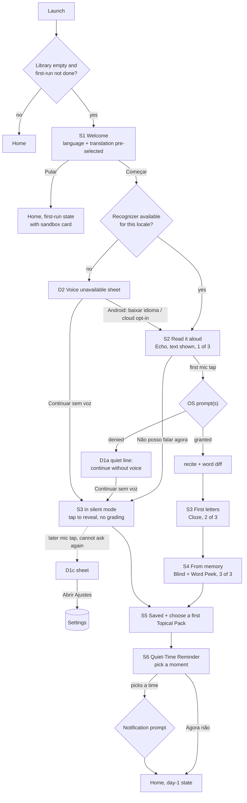

# Onboarding & First-Run Experience (October 2026 Research Pass)

**Author**: Research Agent
**Date**: 2026-10-08
**Status**: Completed
**Question (product owner)**: "Research the best ways I could do my onboarding on the app."
**Context**: Builds on `feature-and-improvement-opportunities.md` (cited below as *the October note*, with its IDs such as S2, V3, P1, E4, C1), `competitive-benchmarks-and-feature-opportunities.md`, ticket 31 (first-run sandbox), ADRs 0002, 0004, 0011, 0013, 0015 and 0016, and `CONTEXT.md` / `PRODUCT.md` / `DESIGN.md`. Notification surfaces are covered by a parallel note (`notification-and-platform-surfaces.md`); this note only places the reminder ask inside the first-run flow.

**Evidence conventions** (same as the October note)
- **Verified**: read in the primary source on 2026-10-08, URL inline.
- **First-party claim**: a company describing its own product or results. Not independent evidence.
- **Inference**: my reasoning from verified facts.
- **Speculative**: thin evidence; treat as a hypothesis to test.
- **UNVERIFIED / NOT FOUND**: no primary source could be found or reached.
- Code citations are `file:line` in `voice-ai-scripture/` at commit `58223ac`.

---

## 1. TL;DR and recommended flow

- **Recommendation: a guided "First Recitation", not a tutorial.** Welcome (language and translation pre-selected from the locale) → **read a short verse aloud** (the mic prompt fires on this first tap; the reading doubles as the mic test) → recite with first letters → recite from memory → save + pick one of three Topical Packs → "When will you recite tomorrow?" (the notification prompt fires here) → Home. Six short screens, about a minute of reciting, two optional questions, all after the aha. No account, no paywall, no priming screen, no carousel (§7).
- **What's broken today** (§2):
  - The OS prompt appears on screen mount while TTS is speaking. On iOS, on the native engine, the speech-recognition alert comes *before* the microphone alert (§3.4).
  - A denial is a dead end.
  - Brazilians land in English.
  - The first verse is 29–33 words, and the first step is recall from the ear with the text hidden.
  - The save dialog says "successfully" after any score and records a fake 100%.
- **Platform rules that shape the flow** (§3):
  - Apple's HIG allows a pre-permission screen only with **one** "Continue" button, **no "Allow"**, and **no cancel**. That is why the recitation screen itself is the context.
  - Android says not to push users to Settings after a denial.
  - Apple 5.1.1(ii) requires consent even for *anonymous* usage data.
  - LGPD treats religious conviction as sensitive data, so telemetry is an opt-in after onboarding (§9).
- **Biggest dependency:** on-device recognition (October note, V3) is what turns two iOS prompts into one *and* makes "your voice stays on this phone" true (§3.4, §6.3).
- **Evidence honesty:** no peer-reviewed study links onboarding design to retention (§4). Duolingo's famous "+20% from delayed signup" is a DAU figure from a 2017 interview. The design rests on platform rules, mastery and implementation-intention research, and measurement (§9).

---

## 2. The current first-run flow in the app

### 2.1 Step by step (commit `58223ac`)

There is no onboarding route. A new user lands on the normal Home Screen, and the only first-run affordance is the ticket-31 sandbox card that appears while the library is empty.

1. **Launch.** `index.ts:8` registers `App`; `App.tsx:5-10` renders `HomeScreen` inside a `SafeAreaProvider`. There is no navigator, no first-run flag and no stored "has onboarded" key (a grep of `src/` for `onboard`, `firstRun` and `welcome` finds only the sandbox card).
2. **Home mounts.** `loadVerses()` reads an empty dashboard (`HomeScreen.tsx:86-88`). At the same time `checkClipboardForDeck()` reads the clipboard on mount and on every foreground (`HomeScreen.tsx:90-113`). On iOS 16+ this can put the system *paste* prompt in front of a brand-new user before anything else (the October note, P1/C6).
3. **What the empty Home shows, top to bottom.**
   - Header "My Memory Verses" and a "⏰ Reminders" button (`HomeScreen.tsx:214-246`).
   - `HabitBanner`: "Start your streak today!" next to **"All caught up! 🎉"** (`HabitBanner.tsx:49,63`). A user who has done nothing is told they are caught up.
   - Tabs "🔥 Due Today (0)" and "📚 All (0)" (`HomeScreen.tsx:285,310`).
   - `SandboxWelcomeCard`, rendered as the list's `ListEmptyComponent` (`HomeScreen.tsx:570-572`).
   - Footer buttons "📖 Browse Topical Packs" and "+ Type Custom Verse" (`HomeScreen.tsx:591-626`).

   That is six tappable actions on the first screen, all in English (the October note, E4).
4. **The sandbox card** (`SandboxWelcomeCard.tsx`).
   - Badge "⚡ 60-Second Quick Start" (`:67`), title "Welcome to Voice AI Scripture! 📖" (`:80`), and a subtitle about "3-tier voice recall (Echo → Cloze → Recite)" (`:91-92`).
   - An English/Português toggle (`:104-158`) that **defaults to English**: `initialLanguage = 'en'` (`:29`), and `HomeScreen.tsx:572` passes no language. Ticket 31 asked for "English (WEB) and Portuguese (Almeida) based on locale or preference", but no locale API is installed (`package.json` has no `expo-localization`). Brazilian users land in English.
   - A preview of the whole of Acts 2:38: **33 words** in the WEB text and **29 words** in the bundled Almeida (counted from `SANDBOX_PASSAGES`, `:15-24`).
   - The CTA "🎤 Try Interactive Recitation (Acts 2:38)" (`:213`).
5. **Tap the CTA.** `HomeScreen.tsx:145-178` swaps the whole screen for `ReviewScreen` with `isSandbox`. The session starts at Level 1, Echo Mode (`ReviewScreen.tsx:79`, `RecitationSession.ts:145`).
6. **The permission prompt fires on screen mount, not on the mic tap.** Two things start at once:
   - Echo Mode auto-speaks the verse through TTS (`RecitationSession.ts:166-168`).
   - `useRecitationSession.ts:53` calls `session.warmUp()`, which calls `voiceInput.requestPermissions()` (`RecitationSession.ts:300-305`).

   So the OS alert appears while the verse is being read aloud, before the user has touched the microphone. Which alert, or alerts, depends on the engine `createDefaultVoiceInput` picks (`VoiceInput.ts:360-394`):
   - **A Groq or OpenAI key is in the bundle:** `CloudAudioVoiceAdapter` → `AudioModule.requestRecordingPermissionsAsync()`, microphone only (`AudioDriver.ts:203-211`).
   - **No key:** `NativeStreamVoiceAdapter` → `ExpoSpeechRecognitionModule.requestPermissionsAsync()` (`VoiceInput.ts:64-74`). On iOS this shows **two alerts**, and the speech-recognition alert comes first. The microphone alert appears only if that one is accepted (§3.4).

   The purpose strings are English-only and name the project slug: "Allow voice-ai-scripture to access your microphone to verify scripture recitation." (`app.json`, `ios.infoPlist` and the `expo-speech-recognition` plugin block). The app's display name is also the slug, `"name": "voice-ai-scripture"`.
7. **The Echo screen.**
   - The card says "Level 1: Echo Mode (Listen & Read Aloud)" and "Listen to the verse spoken aloud, then recite with full text support." (`ScaffoldingLevelCard.tsx:48,58`).
   - But the text is concealed by default, and at Level 1 there are no cloze tokens (`RecitationSession.ts:206-207`). The card body is therefore **blank** until the user finds "Reveal Text" (`ScaffoldingLevelCard.tsx:111`).
   - The voice hint is bilingual (`ReviewScreen.tsx:251-261`). The rest of the chrome is English-only: "← Back", "1. Echo / 2. Cloze / 3. Recite", "Verifying recitation with Voice AI...", "Practice Again" and "Next: Level 2 →" (`ReviewScreen.tsx:120,136-138,274,374,391`).
8. **Tap the mic.** `startReciting` checks permission again (`RecitationSession.ts:324-332`).
   - **On denial**, the session shows the English-only "Microphone permission was not granted." (`:329`) and nothing else. There is no explanation, no "Open Settings" (`Linking` appears nowhere in `src/` or `App.tsx`), and no way to continue without voice.
   - `NativeStreamVoiceAdapter.requestPermissions` returns `res?.granted ?? true` (`VoiceInput.ts:68`), so an unexpected response counts as *granted*. `start()` also re-requests silently (`:89-91`).
   - **No availability check runs before the first attempt.** `isRecognitionAvailable` and `getSupportedLocales` appear only in a test mock (`VoiceInput.test.ts:223`). On a device with no recognizer for the verse's locale, the user only finds out at the first recitation, through recognizer errors that are only `console.warn`ed (`VoiceInput.ts:101-103`; the October note, A1).
   - The sandbox is unmetered (`RecitationSession.ts:335`), so the abuse-prevention limits never apply here.
9. **Three recitations are needed to finish.**
   - "Next: Level 2 →" appears only after a result (`ReviewScreen.tsx:380-393`). The path is therefore Level 1 (from the ear, text hidden) → Level 2 (Cloze) → Level 3 (Blind).
   - The opt-in modal opens automatically once any Level 3 result exists, **pass or fail** (`ReviewScreen.tsx:82-86`), and covers the word-by-word diff.
   - Its copy says "You've successfully tested all 3 tiers of recitation!" (`SandboxOptInModal.tsx:54`) whatever the score.
10. **Save or leave.**
    - "Add to My Verses" (`HomeScreen.tsx:155-175`) adds the verse and hard-codes `streak: 1`, `lastScore: 100` and a review 24 h later, whatever the user actually scored.
    - "Explore App without Saving" (`SandboxOptInModal.tsx:87`) returns to the same empty Home.
11. **Then nothing guides the next step.**
    - No prompt to pick a Topical Pack, and no reminder offer.
    - Once any verse exists the sandbox card is gone for good: it renders only when `allVerses.length === 0` (`HomeScreen.tsx:571`).
    - Verses added from a pack are due immediately (`VerseEngine.ts:76-79`) and open in Level 3 Blind Recitation (`ReviewScreen.tsx:79`). A new user who imports "Paz" is sent straight to blind recall of verses they have never practised (the October note, #10 "adaptive entry level").
12. **Notifications are never requested on first run.** That is correct. The only path is "⏰ Reminders" → `ReminderSettingsModal` → `ReminderService.scheduleDailyNotification` → `requestPermissionsAsync` (`ReminderService.ts:83-87`).
    - **Bug:** the modal then shows "Quiet-Time reminder scheduled for …" without reading `result.success` (`ReminderSettingsModal.tsx:44-58`). A user who denied the permission is told the reminder is scheduled. The parallel notification note owns the fix.
13. **No monetization and no account in the flow.** `PaywallModal.tsx` is not imported anywhere (the October note, §7). `SubscriptionService` sells nothing; it only enforces the abuse-prevention limits. ADR 0002 keeps everything local.
14. **No instrumentation.** No analytics, crash reporting or funnel events exist, so time to first recitation and permission grant rates are unknown.

*Inference:* the minimum path to the save dialog is 2 taps plus 1–2 OS alerts, then three recitations of a ~30-word verse. The first of those is from the ear with the text hidden. At ~1.5 s per word plus the 3.5 s silence window, listening and verification, that is likely **2–4 minutes**, not the 60 seconds the badge promises.

### 2.2 Gaps

| # | Gap | Where | Why it matters |
|---|---|---|---|
| G1 | The mic and speech prompts fire on screen mount, during TTS, before any mic tap. On iOS the native engine shows the speech-recognition alert first (§3.4). | `useRecitationSession.ts:53` → `RecitationSession.ts:300-305` | Apple's own speech sample asks when the speech UI appears, so this is defensible (§3.1). But the screen is blank and talking, so the alert has no visible context. Android's guidance and the field data favour the mic tap (§3.2, E11). |
| G2 | A denial is a dead end: an English one-liner, no Settings link, no non-voice path | `RecitationSession.ts:326-331` | iOS asks only once (§3). A denying user can never reach the "aha" |
| G3 | No recognizer availability or locale check before the first attempt | `VoiceInput.ts:64-74,106-110` | A pt-BR user on an unsupported device fails at the most fragile moment |
| G4 | English default; no locale detection; English purpose strings and chrome | `SandboxWelcomeCard.tsx:29`, `HomeScreen.tsx:572`, `app.json` | The main audience is Brazilian |
| G5 | The first verse is long (29–33 words), and the first step is recall from the ear with the text hidden | `SandboxWelcomeCard.tsx:15-24`, `ScaffoldingLevelCard.tsx:58-111` | An "easy win" is unlikely; the instruction contradicts the screen |
| G6 | The save dialog appears regardless of score, says "successfully", and records a fake 100% | `ReviewScreen.tsx:82-86`, `SandboxOptInModal.tsx:54`, `HomeScreen.tsx:162-171` | Erodes trust in the grading, the product's core promise |
| G7 | Six competing CTAs; "All caught up! 🎉" shown to a new user | `HomeScreen.tsx:214-626`, `HabitBanner.tsx:63` | No single obvious first step |
| G8 | No continuation after the sandbox (pack, reminder); card gone once a verse exists; pack verses open blind | `HomeScreen.tsx:571`, `VerseEngine.ts:76-79` | The habit loop is never set up |
| G9 | A clipboard read on first launch can show the iOS paste prompt first | `HomeScreen.tsx:90-113` | A system prompt with no context, before any value |
| G10 | Tone: "⚡ Quick Start", "🎉", "Voice AI" | `SandboxWelcomeCard.tsx:67,80`, `ReviewScreen.tsx:274,305` | Conflicts with DESIGN.md's "reverent editorial" and PRODUCT.md's "zero gaudy gamification" |
| G11 | No funnel instrumentation | — | Changes cannot be evaluated |
| G12 | No first-run disclosure of where audio goes (device or cloud) | — | The October note, S2; LGPD and Apple 5.1.2(i) |

---

## 3. Platform rules and constraints

### 3.1 Apple (verified 2026-10-08; I re-fetched the Guidelines and the HIG Privacy, Onboarding and Launching pages myself)

The App Review Guidelines footer reads "Last Updated: June 8, 2026". The June changes touched kid safety, 1.2, 4.3 and 4.5.3, none of the sections below ([news](https://developer.apple.com/news/?id=a233fmpw)).

**Permissions: when to ask**
- HIG Privacy: "Ideally, wait to request permission until people actually use an app feature that requires access." Also: "Avoid requesting permission at launch unless the data or resource is required for your app to function" ([HIG Privacy](https://developer.apple.com/design/human-interface-guidelines/privacy#Requesting-permission), change log June 21, 2023).
- HIG Onboarding: "If your app or game needs access to private data or resources before it can function, consider integrating the permission request into your onboarding flow … Otherwise, present a permission request when people first access the specific function that relies on private data or resources" ([HIG Onboarding](https://developer.apple.com/design/human-interface-guidelines/onboarding), change log June 10, 2024).
- Speech framework: "Do not request access to speech recognition if you do not intend to use the feature right away. Instead, delay requests until the user interacts with the portion of your app that uses such features." Apple's own sample, "because the app's interface is dependent on speech recognition, … requests authorization as soon as that interface is visible" ([Asking permission to use speech recognition](https://developer.apple.com/documentation/speech/asking-permission-to-use-speech-recognition)).
- *Inference:* Apple's own sample makes requesting on the mount of a speech screen defensible. G1 is therefore less about legality than about context: the current screen is blank, and the TTS is talking when the alert appears.

**Permissions: the purpose string**
- "Aim for a brief, complete sentence that's straightforward, specific, and easy to understand. Use sentence case, avoid passive voice, and include a period at the end." Apple's good example: "The app records during the night to detect snoring sounds." Bad examples: "Microphone access is needed for a better experience." and "Turn on microphone access." (HIG Privacy).
- "If this key is not present, your app will crash when it attempts to request authorization or use the APIs of the Speech framework" (speech doc above).
- `NSSpeechRecognitionUsageDescription` is described as "why the app is requesting to send user data to Apple's speech recognition servers" ([key reference](https://developer.apple.com/documentation/bundleresources/information-property-list/nsspeechrecognitionusagedescription)). The legacy `SFSpeechRecognizer` path "involves … sending that data to Apple's servers", while "SpeechAnalyzer transcriber modules don't send audio data of the user's voice to Apple's servers" (speech doc).
- **Localize them.** Apple: "localize CFBundleDisplayName, CFBundleName, and all of the UsageDescription keys" ([Managing Info.plist values](https://developer.apple.com/documentation/bundleresources/managing-your-app-s-information-property-list)).

**Pre-permission ("priming") screens: there is an explicit rule** (HIG Privacy, "Pre-alert screens, windows, or views")
- Allowed, but as a fallback: "Ideally, the current context helps people understand why you're requesting their permission. If it's essential to provide additional details, you can display a custom screen or window before the system alert appears." The rules apply to permissions "including camera, microphone, location, …".
- **One button, not "Allow":** "Include only one button and make it clear that it opens the system alert. … Another type of manipulation is using a term like "Allow" to title the custom screen's button. … Use a term like "Continue" or "Next" to title the single button".
- **No exit:** "Don't include additional actions in your custom screen or window, unless needed to obtain a legal consent. For example, don't provide a way for people to leave the screen or window without viewing the system alert — like offering an option to close or cancel."
- The explicit *rejection* language ("will lead to rejection by App Store review"; prohibited designs such as "offering incentives … displaying an image of the alert") sits under the **Tracking requests** subsection, which is about ATT. **NOT FOUND:** any App Review Guideline that names "Allow" buttons or priming screens. The search of the Guidelines' full text for "Allow" returned no match in a permission context. The enforceable hook is 5.1.1(iv) below, plus 5.6: apps must not "force them to share unnecessary data, … or engage in any other manipulative practices".
- *Inference for this app:* a "Not now" button on a dedicated priming screen breaks the HIG, so §7 has **no dedicated priming screen**. The recitation screen is the context, and its other actions ("Listen first", "I can't speak right now") are feature actions, not exits from a pre-alert screen. This reading is mine, not Apple's; keep the mic button the only thing that triggers the alert.

**After a denial**
- "If the person denies permission, the access attempt that initiates the prompt, and any further attempts, fail in a resource-specific way." "always check the authorization status of a feature before accessing it" ([Requesting access to protected resources](https://developer.apple.com/documentation/uikit/requesting-access-to-protected-resources)).
- "If a user denies the app recording permission, they can grant it access in the Privacy & Security section of the Settings app" ([requestRecordPermission](https://developer.apple.com/documentation/avfaudio/avaudioapplication/requestrecordpermission(completionhandler:))).
- `openSettingsURLString` deep-links "to your app's custom settings in the Settings app" ([docs](https://developer.apple.com/documentation/uikit/uiapplication/opensettingsurlstring)).
- "Provide reasonable fallback behavior in situations where the user doesn't grant access" ([Protecting the user's privacy](https://developer.apple.com/documentation/uikit/protecting-the-user-s-privacy)).

**Guideline 5.1.1(iv) Access** (verbatim): "Apps must respect the user's permission settings and not attempt to manipulate, trick, or force people to consent to unnecessary data access. … Where possible, provide alternative solutions for users who don't grant consent. For example, if a user declines to share Location, offer the ability to manually enter an address." ([Guidelines](https://developer.apple.com/app-store/review/guidelines/#data-collection-and-storage)). *Inference:* the microphone *is* necessary for voice grading. Even so, "alternative solutions" points to the silent Cloze path in §7.4.

**Usage data needs consent, even anonymous.** 5.1.1(ii): "Apps that collect user or usage data must secure user consent for the collection, even if such data is considered to be anonymous at the time of or immediately following collection. … Apps must also provide the customer with an easily accessible and understandable way to withdraw consent." This constrains §9. A privacy-policy link is also required in the app (5.1.1(i)).

**Notifications** (only the onboarding-relevant part; the parallel note owns the rest)
- "Make the request in a context that helps people understand why your app needs authorization. In a task-tracking app that sends reminder notifications, you might make the request after the person schedules a first task" ([Asking permission to use notifications](https://developer.apple.com/documentation/usernotifications/asking-permission-to-use-notifications)). This is exactly S6: the user picks a time, then the prompt.
- **Provisional authorization** sends notifications "quietly … they only appear in the notification center's history" with Keep/Turn Off buttons, and needs no prompt (same page). *Inference:* it is a fallback for users who tap "Agora não". Quiet delivery fits PRODUCT.md's "no abrasive alarms", but a reminder nobody sees may not build a habit. Leave it to the parallel note.
- 4.5.4: "Push Notifications must not be required for the app to function". 5.1.2(i): an app "may not require users to enable system functionalities (e.g. push notifications …) in order to access functionality".

**Accounts**
- 5.1.1(v): "If your app doesn't include significant account-based features, let people use it without a login. If your app supports account creation, you must also offer account deletion within the app."
- 4.8 applies only if a third-party or social login sets up "the user's primary account". The app must then also offer a login that limits data to name and email, allows a private email, and does not collect interactions for advertising without consent. Sign in with Apple is the usual way to satisfy this ([4.8](https://developer.apple.com/app-store/review/guidelines/#login-services)).
- *Inference:* with local-only storage (ADR 0002) none of this triggers. Adding Google sign-in for sync later would trigger 4.8 *and* the in-app account-deletion requirement.

**Subscriptions** (for when a paid tier exists; none does today)
- 3.1.2(c): "Before asking a customer to subscribe, you should clearly describe what the user will get for the price."
- DPLA Schedule 2 §3.8(b): "clearly and conspicuously disclose" the title, "Length of subscription", "Price of subscription", and links to the privacy policy and terms ([DPLA](https://developer.apple.com/support/terms/apple-developer-program-license-agreement/#S2), Schedule 2 updated Dec 17, 2025).
- Apple: "In the purchase flow, the amount that will be billed must be the most prominent pricing element in the layout", and for trials "clearly indicate how long the free trial lasts and the price billed once the free trial is over" ([Auto-renewable subscriptions](https://developer.apple.com/app-store/subscriptions/)).
- HIG Apple In-App Purchase (renamed and refined **Sept 17, 2026**): "Let people experience your app before making a purchase" ([HIG](https://developer.apple.com/design/human-interface-guidelines/apple-in-app-purchase)). HIG Onboarding: "Prefer letting people experience your app or game before prompting them for ratings or purchases."
- 3.1.2(a) bars apps that "trick users into purchasing a subscription under false pretenses or engage in bait-and-switch".

### 3.2 Android and Material (verified 2026-10-08)

**Runtime permissions** ([Request runtime permissions](https://developer.android.com/training/permissions/requesting), updated 2026-10-01)
- "Ask for a permission in context, when the user starts to interact with the feature that requires it."
- "Don't block the user. Always provide the option to cancel an educational UI flow, such as a flow that explains the rationale for requesting permissions."
- "If the user denies or revokes a permission that a feature needs, gracefully degrade your app so that the user can continue using your app". Also: "if microphone access is denied, you must still promote full usability of text functionality."
- **On Settings links:** "respect the user's decision. Don't link to system settings in an effort to convince the user to change their decision." And: "persistent nagging to reconsider is not respectful of their choice."
- **Two denials end the dialog:** "if the user taps Deny for a specific permission more than once during your app's lifetime of installation on a device, the user will no longer see the system permissions dialog … It is very important to only prompt users for permissions when they need access to a specific feature; otherwise, you might inadvertently lose the ability to re-request permissions." The Android 11 page states the same rule ([Android 11 permissions](https://developer.android.com/about/versions/11/privacy/permissions)).
- [Best practices](https://developer.android.com/training/permissions/usage-notes): "only prompt for microphone access when a user clicks on the microphone button. Users are more likely to allow a permission that they are expecting." Also: "Don't overburden the user by requesting every permission at app startup."

**Notification permission** ([Notification runtime permission](https://developer.android.com/develop/ui/compose/notifications/notification-permission), updated 2026-10-01; the old URL redirects)
- `POST_NOTIFICATIONS` is a runtime permission on Android 13 (API 33)+. On a fresh install "your app's notifications are off by default."
- Apps targeting 33+ have "complete control over when the permission dialog is displayed".
- Apps targeting 32 or lower get the dialog "the first time your app starts an activity after you create a notification channel … This is usually on app startup".
- Best practice: "Wait to show notification permission prompt … let them familiarize themselves with your app" and "You can trigger a permissions prompt from a user action."
- Swiping the dialog away leaves the state unchanged.

**Material**
- **No onboarding or permissions guideline exists in Material 3** (searched the m3.material.io sitemap and site search; NOT FOUND). The only M3 mention is in content design: "If you have notifications or emails related to the onboarding process, make sure they don't trigger during onboarding" ([M3 notifications](https://m3.material.io/foundations/content-design/notifications)).
- **The archived Material 2 pages still state useful principles.** Label them as archived:
  - From [M2 Onboarding](https://m2.material.io/design/communication/onboarding.html): "Don't force education upfront." "Nudge users to take the first key action." "Each screen should have fewer than ten choices." "After onboarding, the users should land on a screen that makes it easy to act on what they just learned." It also describes a "quickstart" model that "Enables users to quickly get started with the core functionality of the app".
  - From [M2 Permissions](https://m2.material.io/design/platform-guidance/android-permissions.html): "Ask in context: Wait until a feature is invoked to request permission." "Educate in context". "Critical permissions: If the app can no longer run because a critical permission has been denied, explain why that permission must be allowed and offer a button to open Settings". Its "Never ask again" checkbox description predates Android 11.

**Google Play subscriptions** (for when a paid tier exists; [Subscriptions policy](https://support.google.com/googleplay/android-developer/answer/9900533), accessed 2026-10-08)
- "You must be transparent about your offer. This includes clearly and explicitly disclosing your offer terms, the cost of your subscription, the frequency of your billing cycle, the automatic renewal terms, whether a subscription is required to use the app, and any other material information about the subscription. Users should not have to perform any additional action to review the information."
- Listed violations include:
  - "Dismiss button is missing or not clearly visible and users may not understand that they can access functionality without accepting the subscription offer"
  - "Multiple screens in the purchase flow that lead users into accidentally clicking the subscribe button"
  - "Annual subscriptions that most prominently display their pricing in terms of monthly cost"
  - "Subscription pricing and terms that are incompletely localized"
- Free trials: "Be sure to let your users know how and when a free trial will convert to a paid subscription, how much the paid subscription will cost, and how a user can cancel".
- *Inference:* "incompletely localized" makes pt-BR copy of any future offer a compliance item, not a nicety. The dismiss rule matches this app's "never block learners" ethos.

**Platform tension, and how §7 resolves it.** The two platforms conflict on two points:
- Exits from an education screen: Apple forbids them, Android requires them.
- Settings links: Android discourages them as persuasion; M2 and Expo's `canAskAgain` doc ("one should be directed to the Settings app") recommend them.

*Inference:* §7 resolves both conflicts:
- **No education screen.** The mic tap is the context.
- **No Settings push straight after a denial.** The denial response offers "Continue without voice" first. The Settings route appears only when the user later taps the mic again and the OS can no longer ask (`canAskAgain: false`). At that point the user is acting on their own intent, which is not persuasion.

### 3.3 Expo SDK 57 (verified 2026-10-08)

- **`expo-audio`** ([v57](https://docs.expo.dev/versions/v57.0.0/sdk/audio/))
  - `getRecordingPermissionsAsync()` "Checks the current status of recording permissions without requesting them". `requestRecordingPermissionsAsync()` shows the dialog.
  - The response has `status` (`undetermined` / `granted` / `denied`), `granted` and `canAskAgain` ("If not, one should be directed to the Settings app").
  - The config plugin's `microphonePermission` defaults to "Allow $(PRODUCT_NAME) to access your microphone".
  - *Implication:* `AudioDriver.requestPermissions` (`AudioDriver.ts:203-211`) should become "get first, request only on a user action".
- **`expo-notifications`** ([v57](https://docs.expo.dev/versions/v57.0.0/sdk/notifications/))
  - `getPermissionsAsync()` has "no user-facing effect". iOS supports `allowProvisional`.
  - The docs still say the Android 13 prompt is "automatically triggered by the operating system" and "will not appear until at least one notification channel is created". That describes apps targeting API ≤ 32 (§3.2). With the default target SDK, the app must request explicitly, which `ReminderService.ts:73-87` already does after creating the channel.
  - `POST_NOTIFICATIONS` is declared in the library's own AndroidManifest ([sdk-57 source](https://github.com/expo/expo/blob/sdk-57/packages/expo-notifications/android/src/main/AndroidManifest.xml)), so `app.json` does not need it.
- **`expo-localization`** ([v57](https://docs.expo.dev/versions/v57.0.0/sdk/localization/))
  - `getLocales()` returns locales "in the order the user defines in their device settings", "Guaranteed to contain at least 1 element", each with `languageTag`, `languageCode` and `regionCode`.
  - "On Android, the user can change locale preferences in Settings without restarting apps", so re-read it on foreground.
  - Not installed today.
- **Localized permission strings and app name** ([localization guide](https://docs.expo.dev/guides/localization/); confirmed for v57 in the [app config reference](https://docs.expo.dev/versions/v57.0.0/config/app/), `locales`: "Provide per-locale values for System Dialog prompts such as Permissions Boxes")
  - Set `ios.infoPlist.CFBundleAllowMixedLocalizations: true`, then `"locales": { "pt": "./languages/pt.json" }`.
  - Put the keys under `ios` (e.g. `NSMicrophoneUsageDescription`, `NSSpeechRecognitionUsageDescription`, `CFBundleDisplayName`) and `android` (`app_name`).
  - "During prebuild, Expo writes those values to InfoPlist.strings for the corresponding locale."
  - Expo's permissions guide warns that the plugins' boilerplate reasons "will most likely need to be tailored to your specific use case for your app to be accepted" and that "Changes to the Info.plist cannot be updated over-the-air" ([guide](https://docs.expo.dev/guides/permissions/)). The purpose strings ship with a store build, not an update.
- **`Linking.openSettings()`** "Open the Settings app and displays the app's custom settings, if it has any" ([RN 0.86](https://reactnative.dev/docs/0.86/linking)).

**Proposed purpose strings** (active voice, specific, one sentence, per §3.1):

| Key | en | pt-BR |
|---|---|---|
| `NSMicrophoneUsageDescription` | The app listens while you recite a verse aloud so it can check each word. | O app ouve enquanto você recita um versículo em voz alta para conferir cada palavra. |
| `NSSpeechRecognitionUsageDescription` (only while the legacy server-based recognizer is used) | Apple's speech recognition turns your recitation into text so the app can compare it with the verse. | O reconhecimento de voz da Apple transforma sua recitação em texto para o app compará-la com o versículo. |
| `CFBundleDisplayName` | _(owner decision, §11 Q6)_ | _(owner decision)_ |

### 3.4 The speech-recognition library decides how many prompts appear (verified in README and source, 2026-10-08)

`expo-speech-recognition` (jamsch, 57.1.1; [README](https://github.com/jamsch/expo-speech-recognition), [iOS source](https://github.com/jamsch/expo-speech-recognition/blob/main/ios/EXSpeechRecognitionPermissionRequester.swift)):

- **`requestPermissionsAsync()`, which the app calls (`VoiceInput.ts:67,90`):** "On iOS, this requests two permissions: AVAudioSession.RecordPermission and SFSpeechRecognizer.requestAuthorization()." "On Android, this requests RECORD_AUDIO permissions."
- **Order (source):** iOS asks for **speech recognition first**. It asks for the microphone only if speech recognition was authorized. If the user denies the speech alert, the mic alert never appears.
  - *Inference:* a new iOS user on the native engine first sees a prompt about sending their voice to Apple's servers (that is what the key text describes, §3.1), not the more expected microphone prompt.
- **One prompt is possible:** "If you're using on-device recognition on iOS, you just need to request microphone permissions, which can be called with requestMicrophonePermissionsAsync()". Also: "you could enable requiresOnDeviceSpeechRecognition so that you don't use network-based speech recognition (and therefore don't need Speech Recognition permissions) … Android doesn't have a dedicated speech recognition permission so it's safe to only request microphone permissions on both Android and iOS."
  - **This is the strongest onboarding argument for the October note's V3 (on-device first).** It cuts the first-run prompt count from two to one, removes the "Apple's servers" wording, and makes the most reassuring privacy line true (§6.3).
- **After a denial:** "the only way that the permissions can be changed is by the user themselves using the device settings app."
- **Availability:**
  - `isRecognitionAvailable()`: "If this method returns false, calling start() will fail and emit an error event with the code service-not-allowed or language-not-supported." The README then suggests asking iOS users to enable Siri & Dictation, and Android users to install or enable `com.google.android.tts` (Android 13+) or the Google app (≤ 12).
  - `getSupportedLocales()` is "Not supported on Android 12 and below". The source returns empty lists there, and "the service package (such as Bixby) may not be able to return any results".
  - `supportsOnDeviceRecognition()` returns false below API 31.
  - `androidTriggerOfflineModelDownload()` opens a download dialog (Android 13) or downloads directly (14+), and rejects below API 33.
  - iOS speech recognition can also be `restricted` by Screen Time or MDM.
  - **NOT FOUND:** any README guidance for devices without Google services (e.g. Huawei).
- **Error codes to map to D1/D2 rather than to a score:** `not-allowed` ("Permission … was not granted"), `service-not-allowed` ("Recognizer is unavailable"), `language-not-supported`, `network`, `no-speech`, `audio-capture` and `interrupted` (README table).

*Inference for §7.4:* an empty `getSupportedLocales()` on Android ≤ 12 or a Samsung/Bixby service is **not** proof that pt-BR is unsupported. D2 should rely on `isRecognitionAvailable()` plus the first real error code, not on the locale list alone.

### 3.5 Accounts, consent and LGPD (verified 2026-10-08; *not legal advice*)

**No account in onboarding.** Every rule points the same way:
- ADR 0002 keeps all data local.
- Apple 5.1.1(v): "let people use it without a login" (§3.1).
- LGPD makes an account costly. Art. 5 II lists "convicção religiosa" as "dado pessoal sensível … quando vinculado a uma pessoa natural" ([Lei 13.709/2018, compilada](https://www.planalto.gov.br/ccivil_03/_ato2015-2018/2018/lei/l13709compilado.htm)). An account is exactly what would *link* a person to their memorized verses.
- If sync is added later, social login triggers 4.8 and in-app account deletion (5.1.1(v)). Offer it after the habit exists, not in the first run.

**What LGPD requires of anything onboarding collects or sends** (quotes from the compiled law):
- Consent is a "manifestação livre, informada e inequívoca" (Art. 5 XII). "autorizações genéricas … serão nulas" (Art. 8 §4). It "pode ser revogado a qualquer momento … por procedimento gratuito e facilitado" (Art. 8 §5).
- Sensitive data on a consent basis needs consent "de forma específica e destacada, para finalidades específicas" (Art. 11 I). This applies to "qualquer tratamento de dados pessoais que revele dados pessoais sensíveis" (Art. 11 §1).
- Legitimate interest "dificilmente" helps here. ANPD: it "autoriza o tratamento de dados pessoais (não sensíveis)" and is "uma hipótese legal não aplicável ao tratamento de dados pessoais sensíveis" ([Guia Legítimo Interesse, 2024, pp. 5, 8](https://www.gov.br/anpd/pt-br/centrais-de-conteudo/materiais-educativos-e-publicacoes/guia_legitimo_interesse.pdf/@@display-file/file)).
- **The ANPD cookie guide is a partial exception, by analogy only** (it is written for websites). Audience measurement "pode ser amparada na hipótese legal do legítimo interesse" when limited to "dados agregados e sem a combinação com outros mecanismos de rastreamento ou sem a formação de perfis". It warns against pre-selected options: "não é recomendável a utilização de banners … com opções de autorização pré-selecionadas", and against giving "maior destaque apenas ao botão de aceite" ([Guia Cookies, 2022, pp. 18–19, 24, 33](https://www.gov.br/anpd/pt-br/centrais-de-conteudo/materiais-educativos-e-publicacoes/guia-orientativo-cookies-e-protecao-de-dados-pessoais.pdf/@@display-file/file)).
- Before collection, the user must be told the purpose, the controller, any sharing and their rights, "de forma clara, adequada e ostensiva" (Art. 9). Consent obtained with information that was not "apresentadas previamente com transparência" is void (Art. 9 §1).
- Any vendor outside Brazil is an international transfer, and the consent route needs "consentimento específico e em destaque para a transferência, com informação prévia sobre o caráter internacional da operação" (Art. 33 VIII). PostHog EU (Frankfurt) is still a transfer.
- Anonymized data falls outside the law only if it cannot "com esforços razoáveis" be re-identified (Art. 12).
- **ECA Digital** (Lei 15.211/2025, in force since 17 March 2026) covers services "de acesso provável" by children and adolescents. It demands "por padrão, a configuração no modelo mais protetivo disponível" (Art. 7) and settings "que evitem o uso compulsivo" (Art. 8 IV) ([Lei 15.211](https://www.planalto.gov.br/ccivil_03/_ato2023-2026/2025/lei/L15211.htm)). ANPD enforces it. LGPD Art. 14 §1 requires parental consent for children's data.

**Apple adds a stricter rule than LGPD.** 5.1.1(ii): consent is needed for usage data "even if such data is considered to be anonymous" (§3.1). An "anonymous, legitimate-interest" telemetry design that might pass in Brazil therefore still needs an opt-in on iOS.
- ATT is a separate question. Apple defines tracking as linking app data "with user or device data collected from other companies' apps … for targeted advertising", so first-party analytics that are not combined with other data do not need the ATT prompt ([User privacy and data use](https://developer.apple.com/app-store/user-privacy-and-data-use/)). The App Privacy label and Play's Data safety form must still declare "Product Interaction" / "App interactions" for Analytics once any event leaves the device ([App Privacy Details](https://developer.apple.com/app-store/app-privacy-details/), [Data safety](https://support.google.com/googleplay/android-developer/answer/10787469)).

*Inferences for onboarding:*
- **Onboarding itself collects nothing off-device.** Language, translation, pack, reminder time and the first score stay in local storage. On-device data is not "collected" for Apple's label nor "disclosed" for Play's form (quotes above).
- **The only consent onboarding may need is for cloud transcription** (October note, S2). If on-device is the default, there is no consent step before the aha.
- **Telemetry consent comes after onboarding, off by default, with equal buttons** (§9.2). It is never pre-ticked and never a gate.
- **If minors are a plausible audience** (youth groups, EBD), ECA Digital's "most protective by default" points the same way: analytics off, no streak pressure, an age question only if counsel requires it (§11, Q8).

---

## 4. Evidence on onboarding patterns

**How these were checked.** Every DOI was resolved and its Crossref metadata matched. Several publisher sites blocked automated access, so some texts were read from author or repository copies (named below). A sub-agent did this. I re-fetched the Duolingo quotes.

**Strength scale:**
- **Strong**: a large experiment or meta-analysis in a close domain.
- **Moderate**: a solid study in an adjacent domain.
- **Weak**: small, correlational, or a first-party claim.
- **Guidance**: a platform rule, not evidence.

**Headline:** **no peer-reviewed experiment was found that causally links onboarding design or "time to first value" to retention in a consumer app.** The searches covered PubMed and the web. The closest work is Andersen et al. 2012 (games). The baseline everyone faces is steep attrition. For mental-health apps, "The medians of app 15-day and 30-day retention rates were 3.9% … and 3.3%" (Baumel et al. 2019, DOI [10.2196/14567](https://doi.org/10.2196/14567)). Eysenbach's "law of attrition" says "a substantial proportion of users drop out" of any eHealth app (2005, DOI [10.2196/jmir.7.1.e11](https://doi.org/10.2196/jmir.7.1.e11)).

| # | Pattern | Evidence (verbatim where it matters) | Strength | Implication for this app |
|---|---|---|---|---|
| E1 | **Learn by doing vs tutorial carousels** | Andersen et al. 2012, CHI, >45,000 players: "the usefulness of tutorials depends greatly on game complexity … they did not significantly improve player engagement in the two simpler games". Context-sensitive instruction helped only in the complex game (DOI [10.1145/2207676.2207687](https://doi.org/10.1145/2207676.2207687); author PDF). HIG: "Teach through interactivity". Archived M2: "Don't force education upfront." | Moderate (field experiment, but games) + guidance | The core loop (listen → first letters → recite) is simple and teaches itself. **No carousel**: teach each level by doing it once (S2–S4). |
| E2 | **Delayed signup / time to value** | Duolingo's VP Growth, in a 2017 interview on a third-party site: "Simply moving the sign-up screen back a few steps led to about a 20% increase in DAUs". She calls the first test "before my time" ([First Round Review](https://review.firstround.com/the-tenets-of-a-b-testing-from-duolingos-master-growth-hacker/), re-fetched). Speak: "we get you speaking within 10 seconds of starting your first lesson" ([blog, 2026-03-24](https://www.speak.com/blog/how-speak-reinvents-language-learning)). | **Weak**: first-party, secondhand, and the metric is DAU, not retention. It is the *only* source for the often-quoted "+20%", and no Duolingo-owned page quantifies it. Mazal's Lenny's Newsletter piece makes no onboarding claim; it says the team deprioritized "new-user retention" for CURR. | Already the app's design (ADR 0002). Keep the first recitation two taps from launch. Do not cite "+20% retention". |
| E3 | **An early mastery experience ("easy win")** | Bandura 1977: performance accomplishments are "especially influential because it is based on personal mastery experiences. Successes raise mastery expectations; repeated failures lower them, particularly if the mishaps occur early in the course of events" (DOI [10.1037/0033-295X.84.2.191](https://doi.org/10.1037/0033-295X.84.2.191), p. 195). | Strong theory, classic; not app-specific | Make the first recitation nearly certain to succeed (read aloud, short verse). Frame a low first score as an audio problem, not a memory failure. **The current 33-word, text-hidden first step risks exactly the "early mishap".** |
| E4 | **Few questions; each must change something** | Galesic & Bosnjak 2009: "the longer the stated length, the fewer respondents started and completed the questionnaire … answers to questions positioned later … were faster, shorter, and more uniform" (DOI [10.1093/poq/nfp031](https://doi.org/10.1093/poq/nfp031)). Headspace (consultancy case study): a personalization quiz "more than doubled course starts (from ~31% to ~63%)", "But we didn't increase how often new users overall actively meditated" ([Irrational Labs](https://irrationallabs.com/case-studies/headspace-doubled-course-starts/), via Wayback). | Moderate (surveys) / Weak (case study) | **At most two questions, after the aha** (pack, reminder). A quiz can move an intermediate metric without changing the habit. Ask nothing whose answer doesn't change day 1. |
| E5 | **Small, curated choice sets** | Choice overload averages "virtually zero" (D = 0.02; Scheibehenne et al. 2010, DOI [10.1086/651235](https://doi.org/10.1086/651235)). But "higher preference uncertainty" and "decision task difficulty … facilitate choice overload" (Chernev et al. 2015, DOI [10.1016/j.jcps.2014.08.002](https://doi.org/10.1016/j.jcps.2014.08.002)). Archived M2: "Each screen should have fewer than ten choices." | Strong (meta-analyses) | New users are maximally uncertain. Show **three** packs in their language, not the full browser. Pre-select one translation. |
| E6 | **Sensible defaults** | Defaults: "d = 0.68 … defaults are more effective when they operate through endorsement … or endowment" (Jachimowicz et al. 2019, DOI [10.1017/bpp.2018.43](https://doi.org/10.1017/bpp.2018.43)). HIG: "Provide reasonable default settings". | Strong | Pre-select language from the locale, plus the default translation. **Never** pre-select data consent: the ANPD guide (§3.5) and Apple 5.1.1(ii) forbid it. |
| E7 | **Implementation intentions for the reminder** | "Whenever situation x arises, I will initiate the goal-directed response y!" (Gollwitzer 1999, DOI [10.1037/0003-066X.54.7.493](https://doi.org/10.1037/0003-066X.54.7.493)). Meta-analysis: "Findings from 94 independent tests showed … a positive effect of medium-to-large magnitude (d= .65) on goal attainment" (Gollwitzer & Sheeran 2006, DOI [10.1016/S0065-2601(06)38002-1](https://doi.org/10.1016/S0065-2601(06)38002-1)). Calm (vendor case study): "after a user completes their first meditation session, they are shown a screen encouraging them to set a daily reminder", and "40% of users who saw the prompt went on to set" one. The claimed "3x" retention is correlational ([Amplitude](https://amplitude.com/blog/calm-increased-retention-amplitude)). | Strong (meta-analysis) / Weak (vendor) | S6 asks **"when will you recite tomorrow?"** with options anchored to existing routines ("Depois do café"), right after the first success. Let the user pick; don't pre-select a time (*inference*: the plan should be the user's own). |
| E8 | **Habits take weeks, and one miss doesn't break them** | "The median time to reach 95% of asymptote was 66 days, with a range from 18 to 254 days." "Missing one opportunity to perform the behaviour did not materially affect the habit formation process." N = 96 recruited, 82 analysed; the median is for 39 good-fit participants (Lally et al. 2010, DOI [10.1002/ejsp.674](https://doi.org/10.1002/ejsp.674); repository PDF). | Moderate (one field study) | Don't promise "21 days". Day-1 copy and streak messaging should be forgiving. This also supports the ECA Digital "avoid compulsive use" default (§3.5). |
| E9 | **Daily-goal questions** | Duolingo (first-party, 2020): "Establishing a goal appeared to be a barrier to forming a daily habit, and that's the last thing we want at Duolingo." It decoupled streaks from the goal ([blog](https://blog.duolingo.com/improving-the-streak/), re-fetched). Earlier, goal-setting had been *added* to account setup (2017 interview, E2). Commitment devices help "make it easier to fulfill his or her own future plans" (Bryan, Karlan & Nelson; working-paper wording, [Yale EGC 980](http://www.econ.yale.edu/growth_pdf/cdp980.pdf); published as DOI [10.1146/annurev.economics.102308.124324](https://doi.org/10.1146/annurev.economics.102308.124324)). | Weak (first-party) / theory | **No daily-goal question in v1.** The SRS already sets the workload. A pace commitment is an experiment for later (§8). |
| E10 | **Visible progress (goal gradient, endowed progress)** | People "purchase coffee more frequently the closer they are to earning a free coffee" (Kivetz et al. 2006, DOI [10.1509/jmkr.43.1.39](https://doi.org/10.1509/jmkr.43.1.39)). Car wash: "34% versus just 19%" redemption with two free stamps (Nunes & Drèze 2006, DOI [10.1086/500480](https://doi.org/10.1086/500480)). | Strong (field experiments, marketing) | A quiet "1 de 3 / 2 de 3 / 3 de 3". On day 1, the saved first verse is *real* progress toward the pack. No artificial stamps, which would clash with the reverent tone. |
| E11 | **Explain permissions and ask in context** | Purpose strings: "they approved 73.6% of the requests" vs "65.8%" without, and "the actual content of the purpose strings did not have an observable effect" (Tan et al. 2014, CHI, online experiment with mock dialogs, DOI [10.1145/2556288.2557400](https://doi.org/10.1145/2556288.2557400)). Android field study (N = 157, 6 weeks): "participants accepted 84% of the permission requests … denial rates … vary from 23% (for microphone) to 10% (calendar)". The main reason was "users' expectation on whether or not an app should need a permission" (Bonné et al., SOUPS 2017, no DOI, [USENIX PDF](https://www.usenix.org/system/files/conference/soups2017/soups2017-bonne.pdf)). | Moderate | The **microphone is the most-denied permission** in that study, so the fallback (§7.4) is not an edge case. Ask on the mic tap, when the user expects it. The purpose string matters more for being present and specific than for clever wording. |
| E12 | **Speaking anxiety** | "Anxious students feel a deep self-consciousness when asked to risk revealing themselves by speaking … in the presence of other people" (Horwitz et al. 1986, DOI [10.1111/j.1540-4781.1986.tb05256.x](https://doi.org/10.1111/j.1540-4781.1986.tb05256.x)). ASR practice: interviews found "students felt less anxious when speaking in front of the ASR-based websites compared to speaking to peers", **but** the pre/post anxiety scores showed "no significant difference" (Bashori et al. 2022, DOI [10.1080/09588221.2020.1770293](https://doi.org/10.1080/09588221.2020.1770293)). A quasi-experiment (N = 232) reported reduced speaking anxiety against regular classes (Bashori et al. 2021, DOI [10.1016/j.system.2021.102496](https://doi.org/10.1016/j.system.2021.102496); same group; one co-author affiliated with a tested tool). | Weak to moderate; suggestive | Treat the phone as a private listener: no autoplay, no audience framing, "I can't speak right now" always visible. Don't overclaim that voice practice reduces anxiety. |
| E13 | **Notification opt-in after value** | Apple: ask "after the person schedules a first task" (§3.1). Android: "let them familiarize themselves with your app" (§3.2). Duolingo copy tests (first-party): "an 8% increase in opt-in to notifications for German learners! … in Spanish… it had no significant impact" ([blog](https://blog.duolingo.com/copy-testing-experiments/)), and "when we tested copy around building a long-term habit, 5% more learners opted in" ([blog](https://blog.duolingo.com/putting-in-work-the-habit-of-language-learning/)). A micro-randomized mHealth trial found tailored messages made engagement in the next 24 h "3.9% more likely", with timing effects (Bidargaddi et al. 2018, DOI [10.2196/10123](https://doi.org/10.2196/10123); authors hold shares in the app maker). | Guidance + weak | Ask in S6, framed as the user's habit ("Quando você vai recitar amanhã?"). Expect copy to matter modestly and inconsistently across languages, so test pt-BR copy separately. |
| E14 | **The landing screen after onboarding** | Archived M2: "After onboarding, the users should land on a screen that makes it easy to act on what they just learned." HIG: "make sure it's easy for people to find [the tutorial] if they want to view it later." | Guidance only | The day-1 Home state (§7.3). Keep the sandbox card reachable after a skip. |

**Corrections to commonly repeated claims** (from the verification pass):
- **Yancey & Settles 2020** (Duolingo's notification bandit, DOI [10.1145/3394486.3403351](https://doi.org/10.1145/3394486.3403351)) optimizes notification *content*, not timing. Its "2% increase in new user retention" is not evidence about *when* to ask.
- **Fogg's** "trigger" is now called "Prompt" on his own site (B = MAP). The 2009 paper says behavior needs motivation, ability and a trigger that "must occur at the same moment" (DOI [10.1145/1541948.1541999](https://doi.org/10.1145/1541948.1541999)).
  - *Inference:* the first-run maps cleanly onto it. **Prompt** = the mic button with one instruction. **Ability** = read-aloud before recall. **Motivation** = the verse itself, not gamification.

---

## 5. Competitor teardown

**Method.** App Store listings (US and BR storefronts: description, version history, in-app purchases), Play listings where noted, official help centres and websites, and first-party blogs, all accessed 2026-10-08. A research sub-agent collected the rows. I re-fetched the Hallow, Engraved and Duolingo quotes myself.

**Tags:**
- **V**: verbatim on a primary page.
- **V\***: verbatim text, but the onboarding behaviour is *inferred* from it (usually a release note).
- **S**: text printed inside a store screenshot image. No alt text exists.
- **NF**: not found.

**Most onboarding flows are not visible from public pages.** In particular, **no app documents when it asks for the microphone**.

| App | Account wall? | First-run questions | Time to first action | Mic timing / fallback | Notification ask | Paywall in onboarding | Price (US / BR) |
|---|---|---|---|---|---|---|---|
| **Engraved** (voice-graded, on-device) | None: "By default there is no user account" (V) | Stores "translation, reminder time, memory method" (V); order NF | Home: "Today's verse, then 1 review" (S) | Mic "used only while a recitation screen is open and you have started listening"; "You can decline microphone access … recitation can be typed instead" (V) | "at the times you choose" (V); timing NF | None; free, no IAP (V) | Free |
| **ReciteWell** (voice-graded, on-device Whisper) | "No account required" (V) | Welcome → "Choose Your Translation" (KJV/WEB) → "You're Ready" (S) | 3rd screen: "Your first verse is John 3:16 … Begin Verse 1" (S) | "tap the mic and recite"; "no audio is ever uploaded or stored" (V); prompt timing NF | "Daily reminder notifications" (V); timing NF | "first 25 verses are free" (V); none in the onboarding screenshots (S) | $4.99/mo, $39.99/yr / R$29,90/mo, R$249,90/yr |
| **The Bible Memory App** | Account-centric. v7.8: "Option to bypass onboarding and login when first installing" (V\*) | "Redesigned on-boarding to help you start memorizing faster" (v9.1–9.3, May–Jun 2026) (V); contents NF | NF | Speech recognition is a paid Unlimited feature (V); timing NF | "at the time of your choice" (V); timing NF | NF in-app | Unlimited $49.99/yr / R$299,90/yr |
| **Verses** (not updated since 2020) | Sign-in. 2019: "Moved subscription prompt from intro flow to first sign in" (V) | Intro flow exists (V\*) | NF | "Speak Out (beta)" (V) | In Settings (V) | Moved *out* of intro (V) | $4.99–9.99/yr |
| **Memverse** (web) | Sign-up with email confirmation (V); a typing **demo** without an account (V) | NF | Demo: "Type Romans 12:2" (V) | Browser prompt: "Simply allow microphone access when prompted" (V) | NF | None, free (V) | Free |
| **Remember Me** | Email registration, plus an "On-Device Only" option "at the bottom of the registration dialog" (V) | NF | NF | Record and self-check, not graded (V) | NF | "No premium tier … No trial period" (V) | Free |
| **Dwell** (audio Bible) | In-app NF; web offers Apple/Google (V) | NF | "limited amount of free content" (V) | n/a | "daily reminders" (V) | 7-day trial (V); placement NF | $59.99/yr / R$104,90/yr |
| **Hallow** | "Yes. You'll need a Hallow account to use the app, even if you don't have a paid subscription." (V, re-fetched) | "follow the onboarding prompts" (V); questions NF | NF | n/a | NF | **Yes**: plan choice after the prompts, skippable: "tap the **x** in the top right corner" (V, re-fetched); the trial needs a payment method (V) | $69.99/yr / R$249,90/yr |
| **YouVersion** | No wall: "you can use YouVersion without an account", including "28 Plan days" (V) | NF | Plan: "Start Plan → By Myself → Visible to Friends or Private" (V) | n/a | Push requires an account (V) | None: "No Ads or Purchases" (S) | Free |
| **Duolingo** | Soft: "Don't forget to create a profile to save your progress!" (V, re-fetched) | "questions about your motivations and goals", then start from the beginning or "take a placement test" (V, re-fetched, blog 2024-12-02) | Speaking "From your very first lesson" (V) | Timing NF. "You may skip speaking activities" (privacy); "Can't speak at the moment? You can type it instead!" (Flashcards) (V) | **During onboarding**: "you'll be able to turn on notifications so you can establish a study schedule" (V, re-fetched) | 14-day Super trial (V); placement NF | Super from $9.99 / R$31,90 |
| **Anki** | None; sync optional (V) | None documented | NF ("start with the computer version") (V) | "Record Voice", no grading (V) | Optional alert in Preferences (V) | None; paid upfront (V) | $24.99 / R$149,90 |
| **ELSA Speak** | Guest login under A/B test (v9.2.2, Oct 6 2026) (V) | Native language → level → reminder time (older FAQ, V); "Set your daily learning goal during setup" (v9.0.8, V); goal and level pickers (S); "Assessment Test" (V) | "First Lesson Post Onboarding" (v9.2.1, V) | Timing NF. Help explains re-enabling the mic in Settings (V, Vietnamese only) | **During onboarding**: pick a time → "Allow" notification (older FAQ, V) | Paywall A/B tests; 7-day trial (V); position NF | $99.99/yr / R$289,00/yr |
| **Speak** (speaking practice) | Account via "Get Started" (V) | "Let's create your personalized lessons!" with a "What I heard" transcript card (S), i.e. a spoken intake | "getting you speaking … out loud on day 1" (V) | Timing NF. **"Can't speak now" toggle**: "Speak's model pronunciation will speak for you" (V). Troubleshooting asks that both "Microphone" and "Speech Recognition" be permitted (V) | NF | Trial needs an account, a plan and a payment method (V) | $83.99/yr / R$299,90–399,90/yr |

**Notes and patterns**

1. **The newest voice-graded scripture apps have converged on no account, on-device recognition and a fast first verse.**
   - Engraved: "No account, no ads, free"; "No audio is ever uploaded, streamed, stored or transmitted".
   - ReciteWell: "No account required"; on-device Whisper.
   - ReciteWell's screenshots show a three-screen first run: Welcome → Choose Translation → "Your first verse is John 3:16 … Begin Verse 1" (S).
   - *Inference:* the privacy promise is part of the first-run pitch in this category, and both make it with an engine where it is literally true. That supports §6.3.
2. **Typing is the standard voice fallback.**
   - Engraved: "recitation can be typed instead". Speak: "Can't speak now", plus typing in Free Talk. Duolingo: "type it instead".
   - In this app the closest equivalent is Cloze tapping (silent mode, §7.4). Typing-based verification is a possible later addition: it is deterministic and fits ADR 0001, but it is out of scope here.
   - **Note:** the "Can't speak now" toggle is often attributed to Duolingo, but it is **Speak's**, documented on help.speak.com. Duolingo's documented equivalents are "Can't listen now", "type it instead" (Flashcards) and skipping a Video Call lesson.
3. **Language-learning apps ask more up front, and they monetize there.**
   - ELSA asks native language → level → reminder time, then the notification "Allow".
   - Duolingo asks motivation and goals, offers notifications during onboarding, then placement.
   - Hallow puts a skippable plan and trial screen right after its prompts, behind an account wall.
   - *Inference:* those questions feed paid personalization or trials. This app has neither, so copying the question count would add cost without benefit (§4).
4. **Incumbents are moving the paywall and login *out* of the intro.** Verses moved the "subscription prompt from intro flow to first sign in" (2019). The Bible Memory App added an "Option to bypass onboarding and login" (2024) and then "Redesigned on-boarding to help you start memorizing faster" (2026). Both are V\*: the release notes say *that* it changed, not what users see.
5. **Duolingo and ELSA iterate onboarding continuously, by their own account (first-party claims).** ELSA's 2026 release notes alone list "A shorter, smoother onboarding", "First Lesson Post Onboarding", "Guest Login A/B Test", "New Professional Paywall UI (A/B Test)" and "D0D1 Retention improvements". *Inference:* onboarding is treated as a product surface to measure and tune (§9), not a one-off.
6. **YouVersion is the relevant local precedent for "useful without an account".** Plans can be started and completed for 28 days without signing up. Progress "will sync to your new account after sign-up if you use the same device" (V). That is the pattern ADR 0002 already implies for future sync.
7. **No competitor in this set grades spoken pt-BR.** This confirms the October note's C1. Engraved and ReciteWell list English only (V/S).
8. **Not verifiable:** Hallow's onboarding questions and trial length, the Bible Memory App's new onboarding screens, Speak's and the Bible Memory App's login providers, Duolingo's Sign in with Apple, and every app's microphone-prompt timing. Third-party teardown sites were not used.

---

## 6. Voice-specific onboarding

### 6.1 How speaking apps get people talking (verified where tagged; details in §5)

- **Speak first, explain never.** Speak says it gets "you speaking within 10 seconds of starting your first lesson" and "out loud on day 1". Duolingo: speaking "From your very first lesson". Both are first-party claims. Speak's screenshots show a spoken intake ("Let's create your personalized lessons!" with a "What I heard" transcript card, S).
- **No competitor documents a separate "mic test" step** (NF for all 13 apps). *Inference:* the market uses the first real exercise as the microphone check. §7's S2 does the same: reading the verse aloud *is* the mic test, and its result line is phrased as an audio check ("Every word came through clearly").
- **A visible way out of speaking is standard.**
  - Speak: "Can't speak now", where "Speak's model pronunciation will speak for you".
  - Duolingo: "Can't speak at the moment? You can type it instead!", plus "You may skip speaking activities".
  - Engraved: "recitation can be typed instead".
- **A privacy promise is part of the pitch for voice scripture apps.** Engraved: "No audio is ever uploaded, streamed, stored or transmitted". ReciteWell: "no audio is ever uploaded or stored". Both run on-device, so the promise is true. §6.3 explains why this app can only say the same once V3 ships.
- **A spoken placement step ("verses you already know") exists in language apps** (ELSA's "Assessment Test"), but is rejected for v1 (§8).

### 6.2 Self-consciousness: design responses

The evidence (E12) is that speaking in front of others is the main anxiety trigger, and that a machine listener *may* feel safer. That is suggestive, not proven. The design therefore removes audiences and surprises rather than relying on persuasion:

- **No surprise audio.** Echo TTS plays only on "Ouvir primeiro" (§7.3). Today it auto-plays on mount (`RecitationSession.ts:166-168`).
- **The user controls the start, and the end is visible.**
  - Recording starts only on the mic tap.
  - The button glows while listening, which also satisfies Apple 2.5.14's "clear visual … indication when recording" (October note §3.4).
  - Silence auto-completion keeps its 3.5 s Thinking Grace Period (ADR 0015), so a pause to remember does not end the attempt.
- **A quiet voice is fine.** *Speculative, test it:* add "Pode falar baixo, perto do telefone." / "You can speak softly, close to the phone." Recognizer accuracy at low volume is unmeasured for this app.
- **Always an exit.** "Não posso falar agora" is visible on every voice step.
- **Results are private and gentle.** Diff colours are DESIGN.md's "quiet" tones. No sounds or haptics on a result (ADR 0004). No score shown on S2 when everything passed: just the sentence.

### 6.3 The privacy line must match the engine (verified from code and Apple docs)

| Engine (`createDefaultVoiceInput`, `VoiceInput.ts:360-394`) | What happens to audio today | Copy that is true |
|---|---|---|
| `NativeStreamVoiceAdapter`, no on-device flag (today's no-key path) | No audio file is written by the app (`VoiceInput.ts:45-49`). The iOS legacy `SFSpeechRecognizer` "involves capturing audio of the user's voice and sending that data to Apple's servers" (§3.1). Android's recognizer "is likely to stream audio to remote servers" unless on-device is used (the October note, §3.4). | "Your phone's speech recognition transcribes it; no recording is kept in the app." **Not** "on this phone". |
| Native with `requiresOnDeviceRecognition` and confirmed support (October V3) | Stays on the device | "Transcribed on this phone and not saved." |
| `CloudAudioVoiceAdapter` (Groq / OpenAI) | An `.m4a` is recorded, uploaded, then deleted in `finally` (`VoiceInput.ts:248-266`). Vendor retention differs (Groq up to 30 days unless ZDR; the October note, §3.4). | "Sent securely for transcription and deleted right after", only with S2 consent and ZDR on. |

*Inference:* a reassuring but false line ("nobody hears you", "nothing leaves your phone") would be worse than none. It breaks the trust the grading depends on, and it is a 5.1.2(i) and LGPD Art. 9 problem. This is one more reason to make on-device the default (S2/V3) *before* the onboarding ships: it is the only engine where the most reassuring sentence is also true.

### 6.4 Choosing the first verse

The first recitation must be short, have no proper nouns the recognizer may garble, and match the wording the user already carries. Word counts and texts below are from the bundled datasets (`src/data/bibles/*.json`).

| Candidate | Words | Text in the bundle | Risks |
|---|---|---|---|
| Acts 2:38 (today) | 33 (WEB) / 29 (Almeida) | "Peter said to them, "Repent, and be baptized…"" | Long. Leading narrative frame ("Peter said to them"). Names. A doctrinally debated verse (baptism) as everyone's first verse is a choice the owner should make deliberately (*speculative*: may put off some traditions). |
| Psalm 23:1 (WEB) | 8 | "Yahweh is my shepherd: I shall lack nothing." | "Yahweh" is an ASR risk, and the wording differs from the familiar KJV/NIV "The LORD is my shepherd; I shall not want". The bundled KJV adds "[A Psalm of David.]" and "{is}" (L5). |
| **Psalm 119:105 (WEB)** | 14 | "Your word is a lamp to my feet, and a light for my path." | Plain vocabulary, no names, close to the KJV ("Thy word is a lamp unto my feet…"), and on-theme. **Recommended for en.** |
| Philippians 4:13 (WEB) | 10 | "I can do all things through Christ, who strengthens me." | Good alternative; KJV/NIV wording differs more. |
| **Salmos 23:1** (pt) | 9 (bundled Almeida) / 10 (ONBV) | Almeida: "O Senhor é o meu pastor; nada me faltará." ONBV: "O Senhor é o meu pastor; de nada terei falta." | Probably the most familiar verse in Brazilian churches. But **the bundled Almeida is not shippable** (L1), and the ONBV wording "de nada terei falta" differs from the "nada me faltará" most people know. **Recommended for pt** in whichever licensed text keeps "nada me faltará"; otherwise the S4 interference note in §7.4 applies. |
| João 3:16 (pt) | 28 (Almeida) / 26 (ONBV) | — | Too long for a first win. Keep it as a suggested next verse. |

*Inference (interference):* a familiar verse in an unfamiliar translation is not an easy win. In the Blind step people produce the wording they already know, and the diff marks it wrong. That is unfair at the very moment trust is formed. The S2 read-aloud and S3 Cloze steps prime the new wording, and the §7.4 note explains differences. But the real fix is shipping the translation Brazilians actually memorize (October note L6: ARA/NAA via SBB). This makes the translation decision (§11, Q2) an onboarding decision too.

### 6.5 Recognition unavailable for the locale or device

Summarized from §3.4 and §7.4:
- **Check before the first recitation:** `isRecognitionAvailable()`.
- **Trust the first real error code over the locale list.** An empty `getSupportedLocales()` is normal on Android ≤ 12 and on Samsung/Bixby services.
- **Offer the platform fix:**
  - iOS: Siri & Dictation.
  - Android 13+: `com.google.android.tts` or the offline model download.
  - Android ≤ 12: the Google app.
- **Cloud is an opt-in fallback,** and only once the server proxy exists (S1).
- **The silent path is always available.**
- **Infrastructure failures are never scored** (October note, A1/V2; ADR 0006). This matters most in the first session, where a false "failure" teaches the user that the grading is unreliable.
- **NOT FOUND:** guidance for devices without Google services (e.g. Huawei). Treat them as D2 until tested.

---

## 7. The recommended onboarding flow

### 7.1 Design rules (each traced to §3–§6)

1. **Value before asks.** The first thing a user does is recite. Questions come only after the first successful recitation, and there are at most two of them (pack, reminder time). Language and translation are pre-selected, not asked.
2. **One system prompt per moment, each in context.** The microphone (and, on the native engine, speech recognition) prompt appears on the first mic tap. The notification prompt appears only after the user picks a reminder time. Nothing is requested at launch.
3. **No dedicated pre-permission screen.** The recitation screen itself is the context. If a pre-alert screen is ever added, it has exactly one button, "Continuar" / "Continue", no "Permitir" / "Allow", and no cancel (HIG, §3.1).
4. **Never a dead end, never a nag.** Every denial or unavailability has a way to continue without voice (Guideline 5.1.1(iv): "provide alternative solutions"; Android: "gracefully degrade"). The Settings route appears only when the user taps the mic again (§3.2).
5. **Short and true.** A short verse (≈ 8–14 words), so the three scaffold levels take about a minute. All copy, especially the privacy line, must be true for the engine actually in use.
6. **Reverent register.** No emoji, no "Quick Start", no confetti. Serif for scripture, sans for chrome (DESIGN.md). Quiet progress ("1 de 3").
7. **Skippable.** A "Pular" / "Skip" link on every step returns to Home, where an improved version of the ticket-31 card remains as the fallback entry point. Onboarding never re-launches by itself (HIG: "don't present it again on subsequent launches").

### 7.2 Flow

ASCII summary: `Welcome → Read aloud (mic prompt here) → First letters → From memory → Save + pack → Reminder (notification prompt here) → Home`. The voice-less branch joins at "First letters".

### 7.3 Screen by screen

The copy below uses the "você" register and Brazilian evangelical vocabulary ("versículo", "devocional"). pt-BR equivalents for the CONTEXT.md terms are a proposal (§11, Q5). `{ref}` and `{verse}` are placeholders.

**S1 · Welcome** (goal: set the promise and the language, no questions)

| Element | pt-BR | en |
|---|---|---|
| Hero (serif) | Psalm 119:11 in the active translation, e.g. "Escondi a tua palavra no meu coração, para não pecar contra ti." | "I have hidden your word in my heart, that I might not sin against you." (WEB) |
| Title | Guarde a Palavra no coração, em voz alta. | Hide the Word in your heart, out loud. |
| Body | Recite um versículo e veja, palavra por palavra, o que você já guardou. | Recite a verse and see, word by word, what you have already kept. |
| Meta line | Tradução: {translation} · Alterar | Translation: {translation} · Change |
| Primary | Começar | Begin |
| Secondary | English | Português |
| Skip | Pular | Skip |

- **Language:** from `expo-localization` `getLocales()[0].languageCode`: `pt` → pt-BR, anything else → en. The secondary link switches language in place.
- **Translation:** the default for the language (§11, Q2). "Alterar" opens a two-row sheet, not a screen.
- **No account, no permissions, no network.**
- The hero quote must come from the shipping text. The Almeida wording shown is the bundled text that the October note flags as not shippable (L1).

**S2 · Read it aloud** (goal: a near-certain first success that doubles as the microphone check; the system prompt appears here, on the first tap)

| Element | pt-BR | en |
|---|---|---|
| Step | 1 de 3 | 1 of 3 |
| Verse (serif, full text visible) | {verse} | {verse} |
| Instruction | Leia em voz alta, no seu ritmo. | Read it aloud, at your own pace. |
| Under the mic, before the first tap (status undetermined) | Ao tocar, seu telefone vai pedir permissão para ouvir sua voz. | When you tap, your phone will ask permission to hear your voice. |
| Privacy line, native engine *without* on-device recognition (today) | Só ouvimos enquanto o botão estiver aceso. O reconhecimento de voz do sistema transcreve sua leitura; nenhuma gravação fica guardada no app. | We listen only while the button glows. Your phone's speech recognition transcribes it; no recording is kept in the app. |
| Privacy line, on-device recognition confirmed (after V3) | Só ouvimos enquanto o botão estiver aceso. Sua voz é transcrita neste aparelho e não fica gravada. | We listen only while the button glows. Your voice is transcribed on this phone and is not saved. |
| Privacy line, cloud engine (only after S2 consent) | O áudio é enviado com segurança para transcrição e apagado em seguida. | The audio is sent securely for transcription and deleted right after. |
| Tertiary actions | Ouvir primeiro · Não posso falar agora | Listen first · I can't speak right now |
| Result ≥ 80% | Todas as palavras foram ouvidas com clareza. | Every word came through clearly. |
| Result < 80% (framed as an audio check, not a memory failure) | Algumas palavras não chegaram com clareza. Tente um lugar mais silencioso ou aproxime o telefone. | Some words didn't come through clearly. Try a quieter spot, or hold the phone a little closer. |
| Next | Próximo: com as iniciais | Next: with first letters |

- **Mechanics:** this is Echo Mode with "Reveal Text" on by default and `autoVocalizeOnLevel1` off. The TTS plays only on "Ouvir primeiro", so a user in a quiet room or on a bus is not surprised by audio.
- **Permission timing:** `warmUp()` must not request permission while the status is *undetermined*. Read the status first. The first mic tap requests; on grant, warm up and start listening.
- **One alert, not two:** when on-device recognition is supported (October V3), call `requestMicrophonePermissionsAsync()` only. Otherwise iOS shows the speech-recognition alert first and the microphone alert second (§3.4). Either way, the alerts follow the user's own tap.

**S3 · First letters** (goal: retrieval with a strong cue)

| Element | pt-BR | en |
|---|---|---|
| Step | 2 de 3 | 2 of 3 |
| Instruction | Agora, só com as primeiras letras. | Now, with only the first letters. |
| Hint | Toque numa palavra se precisar vê-la. | Tap a word if you need to see it. |
| Result ≥ 80% | Bem lembrado. | Well remembered. |
| Next | Próximo: de memória | Next: from memory |

- **Silent mode** (after "Não posso falar agora", a denial, or no recognizer): the same Cloze card, but the user taps through. The button reads "Conferi" / "I checked it". No score is recorded.

**S4 · From memory** (goal: the aha, "I just said a verse from memory and the app confirmed it word by word")

| Element | pt-BR | en |
|---|---|---|
| Step | 3 de 3 | 3 of 3 |
| Instruction | Agora, de memória. | Now, from memory. |
| Hint | Travou? Toque numa lacuna para espiar uma palavra. | Stuck? Tap a blank to peek at one word. |
| Pass | Você acabou de recitar {ref} de memória. | You just recited {ref} from memory. |
| Pass, sub-line | É assim que cada versículo é guardado aqui: ouvir, lembrar pelas iniciais, recitar. | This is how every verse is kept here: hear it, recall it from the first letters, recite it. |
| Not yet | Quase. Pratique mais uma vez ou siga em frente — {ref} volta amanhã para revisão. | Almost. Practise once more, or continue — {ref} comes back tomorrow for review. |
| Next | Continuar | Continue |

- The diff stays visible; no modal covers it (fixes G6).
- **Scheduling:** save the verse automatically with its *real* score through `recordReview`. Do not hard-code 100 (G6). Offer "Desfazer" / "Undo" on S5.

**S5 · Saved, and a first Topical Pack** (goal: turn one verse into a habit-sized set; this is the personalization question, asked after value)

| Element | pt-BR | en |
|---|---|---|
| Confirmation | {ref} foi guardado nos seus versículos. · Desfazer | {ref} is saved in your verses. · Undo |
| Question | Por onde você quer continuar? | Where would you like to continue? |
| Options | Paz · Fé · Esperança (3 versículos cada) | Peace & Anxiety · Faith & Courage · Strength (3 verses each) |
| Secondary | Escolher outro versículo · Depois | Choose another verse · Later |

- Three options from `topicalPacks.ts`, filtered to the active language. The choice doubles as the "why are you memorizing?" signal, so there is no separate motivation quiz.
- "Escolher outro versículo" opens the existing Reference Picker.
- **Dependency:** new pack verses must open in Echo or Cloze, not Blind (the October note, #10). Otherwise this screen sends the user into the G8 cliff.
- **Deep links:** if the user arrived through a shared deck link (once P1 exists), replace this screen with "Adicionar o conjunto {deck}?".

**S6 · Quiet-Time Reminder** (goal: an implementation intention, "when X, I will recite")

| Element | pt-BR | en |
|---|---|---|
| Question | Quando você vai recitar amanhã? | When will you recite tomorrow? |
| Body | Escolha um momento que já faz parte do seu dia. Enviaremos um lembrete discreto por dia. | Pick a moment that is already part of your day. We'll send one quiet reminder a day. |
| Options | Ao acordar · 6h30 / Depois do café · 8h / No almoço · 12h30 / Antes de dormir · 21h / Outro horário | When I wake up · 6:30 / After breakfast · 8:00 / At lunch · 12:30 / Before bed · 9:00 PM / Another time |
| Primary (after a choice) | Quero o lembrete | Set the reminder |
| Secondary | Agora não | Not now |
| If notifications are denied | Tudo bem. Você pode ativar o lembrete depois em Lembretes. | That's fine. You can turn the reminder on later in Reminders. |

- **Wording:** "Quero o lembrete" is the user's own choice of a feature, not a pre-alert button. It still avoids "Permitir" / "Allow".
- **Truthful copy:** the body promises only "one quiet reminder a day". It must not say "only when verses are due" until the notification note's due-aware reminder ships (the October note, P2).
- **Platform specifics** (Android 13 channel order, iOS provisional authorization) are in §3.3 and the parallel note.

**Home, day-1 state.** Replace "All caught up! 🎉" with "Seu primeiro versículo volta amanhã." / "Your first verse comes back tomorrow." Show the pack verses as "Para praticar hoje" / "To practise today".

### 7.4 Denials and edge cases

| Case | Detection | Response (pt-BR / en) |
|---|---|---|
| **D1a · Just denied** (any platform) | Permission response `granted: false` | No persuasion and no Settings button at this moment (Android: "Don't link to system settings in an effort to convince the user", §3.2). Show one quiet line: "Tudo bem. Você pode continuar com as iniciais, sem voz." / "That's fine. You can continue with first letters, without voice." Primary: "Continuar sem voz" / "Continue without voice". The mic button stays visible. |
| **D1b · User taps the mic again later, and the OS can ask** (Android `canAskAgain: true`) | `getPermissionsAsync()` | Show the system dialog again. This is user-initiated, so it is in context. Android allows only one more denial before the dialog stops (§3.2). |
| **D1c · User taps the mic again, and the OS cannot ask** (iOS after any denial; Android after two) | `canAskAgain: false` / `status: denied` | Sheet, opened by the user's own tap: "O microfone está desativado para este app. Para recitar em voz alta, ative-o nos Ajustes." / "The microphone is off for this app. To recite aloud, turn it on in Settings." Buttons: "Abrir Ajustes" (Android: "Abrir Configurações") / "Open Settings" (`Linking.openSettings()`), and "Agora não" / "Not now". On iOS name the switch the user must find: Microfone, or Reconhecimento de Fala when that was the alert denied (§3.4). |
| **D1d · Restricted** (iOS Screen Time / MDM: `restricted`) | Response field | "O reconhecimento de voz está bloqueado pelas restrições deste aparelho." / "Speech recognition is blocked by this device's restrictions." Silent mode only. |
| **D2 · No recognizer for the locale or device** | `isRecognitionAvailable()` before S2, then the first `service-not-allowed` / `language-not-supported` error (§3.4). Don't rely on an empty `getSupportedLocales()`, which is normal on Android ≤ 12 and Bixby. A missing native module (Expo Go) makes `VoiceInput.ts:151-161` throw `unavailable`. | "O reconhecimento de voz em português não está disponível neste aparelho." / "Speech recognition in English isn't available on this device." Options: (iOS) "Ative Siri e Ditado nos Ajustes" / "Turn on Siri & Dictation in Settings"; (Android 13+) "Baixar reconhecimento em português" (`androidTriggerOfflineModelDownload`) or enable the Google speech service; "Usar transcrição online", only with S2 consent and only once a server proxy exists (S1); "Continuar sem voz". |
| **Recognizer returns empty or error mid-recitation** | Error event or empty transcript | Show as a retry ("Não ouvimos nada. Tente de novo."), never as a score (the October note, A1/V2). |
| **Wants to keep a familiar wording** (e.g. says "nada me faltará" against a different translation) | Diff shows substitutions | S4 "Not yet" copy, plus a one-time note: "Esta tradução diz: …" / "This translation reads: …" (§6.4) |
| **Public place or self-conscious** | "Não posso falar agora" | Silent mode for S3; S4 is skipped and the verse is saved unreviewed. Home later shows "Quando estiver num lugar tranquilo, recite {ref}." |
| **VoiceOver / TalkBack on** | `AccessibilityInfo.isScreenReaderEnabled()` | Don't auto-play TTS. Announce results. Mic button labels already exist in pt/en (`FloatingMicButton.tsx:67-74`). |
| **Existing user updates the app** | Library not empty | Never show onboarding; mark it done. |
| **App killed mid-flow** | Persisted step | Resume at the last step (HIG "Launching": restore state). After two abandoned attempts, land on Home with the card. |
| **Offline at first launch** | — | Everything works on the native engine with a downloaded model. Cloud is never needed in onboarding. |
| **iOS paste prompt at launch** (G9) | — | Remove clipboard polling first (P1). Otherwise the first system dialog a user sees has no context. |

---

## 8. Alternatives considered

| Alternative | What it would look like | Why it was rejected (or deferred) |
|---|---|---|
| **Intro carousel** (3–4 swipe cards: "Recite", "See every word", "Remember for life") | Static slides before Home | HIG: "Teach through interactivity". Tutorial evidence is weak for simple core loops (§4). Every slide delays the aha. The scaffold levels are learned better by doing them once. |
| **Dedicated pre-permission screen** ("Precisamos do microfone" + "Continuar") | One screen before the first recitation | Allowed by the HIG, but only with a single "Continue" button and no way out. That conflicts with the "I can't speak right now" exit the self-conscious user needs. The recitation screen gives better context (§3.1). Keep it in reserve if the measured mic grant rate is low (§9). |
| **Ask all permissions up front** (mic, speech, notifications) | One permissions step at launch | Against Apple's and Android's "in context" guidance (§3). A notification prompt before any value is the classic low-intent ask. |
| **Account or sign-up wall** | Email, Google or Apple sign-in before use | ADR 0002 (no accounts), Guideline 5.1.1(v) ("let people use it without a login"), and LGPD: an account links religious-practice data to an identity (§3.5). It also adds 4.8 and in-app deletion duties. Defer until sync is requested, and then offer it *after* habit formation as "Guardar na nuvem". |
| **Personalization quiz** (denomination, why, how much time, which translation at church, experience) | 4–8 questions before the first recitation | Survey-length evidence (§4): each question costs completion and is answered with less care. Most answers would not change what the app does on day 1. The one useful signal (theme) comes from the pack choice in S5. Revisit only if a question would change behaviour, e.g. "translation you use at church" once licensed texts exist (L6). |
| **Daily goal / pace commitment** ("1 versículo por semana") | A commitment screen in S6 | Plausible as a commitment device (§4), but the SRS already sets the workload, and an unmet self-set goal risks the "SRS guilt" the earlier note warns about. Test later as an A/B arm, not in v1. |
| **Paywall or trial at the end of onboarding** | A "Start your free trial" screen after S6 | Nothing is for sale (§2, step 13). CONTEXT.md promises learners are "never blocked or confronted with commercial quota anxiety". The HIG prefers experience before purchase prompts. When a premium tier exists, introduce it in context (e.g. on the first long passage, or with "Higher-accuracy cloud transcription" next to the S2 consent), with 3.1.2(c) and Schedule 2 disclosures on iOS and Play's Subscriptions policy on Android (§3.1, §3.2). |
| **Placement / "verses you already know"** | Recite any verse you know; the app detects and adds it | Attractive for church-goers who know many verses. But it needs reference detection from free speech and a much more robust ASR path (the October note, A3). High failure risk at the worst moment. Defer. |
| **Start with the user's own favourite verse** | Reference Picker first, then recite | High personal relevance. But it is three to four extra taps, a possibly long verse, and translation-wording interference (§6.4). Offered as the S5 secondary action instead. |
| **Keep the current ticket-31 card as the only onboarding** | Fix copy and defaults only | That is Stage 0 (§10), worth doing anyway. But the card competes with five other CTAs (G7), and nothing continues after it (G8). The guided flow keeps the card as the "Pular" fallback. |
| **Hands-free voice-only onboarding** (TTS speaks the instructions, the user answers by voice) | No reading required | Aligned with the commute vision, but the first session is when users most need to *see* the word-by-word feedback. Revisit once the hands-free loop (October C4) exists. |
| **Auto-play Echo TTS on the first screen** (the current behaviour) | Verse is read aloud on mount | Surprise audio in public works against the self-conscious user. It overlaps the permission alert (G1), and it conflicts with VoiceOver. "Ouvir primeiro" is opt-in instead. |

---

## 9. Measurement plan

### 9.1 Three layers, cheapest first

| Layer | What it measures | Consent | Effort | Limits |
|---|---|---|---|---|
| **L0 · Store analytics** (no SDK) | App Store Connect retention: "the percentage of active devices that installed the app on the selected day and opened the app a certain number of days later" ([Apple](https://developer.apple.com/help/app-store-connect-analytics/engagement/app-retention)). Play Console retention. Product Page Optimization (up to three treatments, 90 days) and Play store listing experiments for page → install. | None from the app. Apple's retention covers only users who opted in to share diagnostics with Apple. | None | No in-app steps. Sampled. Before/after comparisons only. |
| **L1 · Local funnel log** | An append-only `firstRunLog` in AsyncStorage: step timestamps, permission results, first score bucket, assigned variant. Readable in a `__DEV__` tray and in TestFlight / internal builds. | None; it never leaves the device (§3.5). | S | Only testers see it. |
| **L2 · Opt-in upload** | The L1 log plus later D1/D7 "app opened" pings, sent to one vendor. | Opt-in after onboarding (§9.2); Art. 11 I + Art. 33 VIII wording; revocable in Settings. | S–M | Consenting users only. Both experiment arms are filtered equally *if* the consent ask comes after variant exposure and is the same for every arm. |

**Vendor choice for L2** (vendor claims, verified on their pages 2026-10-08):
- **PostHog React Native** ([docs](https://posthog.com/docs/libraries/react-native)) fits best.
  - Expo-compatible, "no mobile native dependencies outside of supported Expo packages".
  - `defaultOptIn: false` ("the SDK will not track until the optIn() function is called"), `disableGeoip`, `captureScreens: false`, `before_send` to drop fields, offline queueing.
  - Experiments are built on feature flags, and flags can be bootstrapped locally.
  - EU Cloud (Frankfurt), with "IP data capture … disabled by default".
  - "First 1,000,000" events and flag requests free ([pricing](https://posthog.com/pricing)).
- **EAS Observe** is the Expo-native alternative: an "anonymous ID that is unique per app installation", `Observe.logEvent('onboarding.completed')` and "100,000 events per month on the Free plan". It has no funnel docs and does not run in Expo Go ([docs](https://docs.expo.dev/eas/observe/introduction/)).
- **Aptabase** markets "no consent banner", but rotates its identifier every 24 hours, so it "makes it impossible to correlate sessions across days". It cannot measure D1/D7 and has no experiments ([docs](https://aptabase.com/docs)). Apple 5.1.1(ii) would still require consent.
- **Firebase** needs `@react-native-firebase` and a development build, and "may process and store your data anywhere Google … maintain[s] facilities" ([Expo guide](https://docs.expo.dev/guides/using-firebase/), [Firebase privacy](https://firebase.google.com/support/privacy)).
- **EAS Update rollouts** are documented for catching bugs, not for A/B assignment. They are also unavailable while `"updates": {"enabled": false}` (`app.json`; [docs](https://docs.expo.dev/eas-update/rollouts/)).

### 9.2 Consent card (after S6, or on the day-1 Home; never inside the first recitation)

| Element | pt-BR | en |
|---|---|---|
| Title | Ajude a melhorar o app? | Help improve the app? |
| Body | Se você permitir, enviaremos dados de uso sem nome nem e-mail — quais etapas você concluiu e se voltou ao app — para um serviço de análise na União Europeia. Nunca enviamos versículos, gravações ou transcrições. Você pode desativar quando quiser em Ajustes. | If you agree, we'll send usage data without your name or email — which steps you finished and whether you came back — to an analytics service in the European Union. We never send verses, recordings or transcripts. You can turn this off at any time in Settings. |
| Buttons (equal weight) | Enviar dados de uso · Não enviar | Send usage data · Don't send |

Nothing is pre-selected and both buttons look the same (ANPD cookie guide). The card names the purpose, the destination and revocation (Arts. 9, 11 and 33 VIII). Store the consent version and timestamp locally, as in the October note's S2.

### 9.3 Events (counters and buckets only; no references, no transcripts, no free text)

| Event | Properties | Answers |
|---|---|---|
| `fr_started` | `lang`, `os`, `variant` | Funnel entry |
| `fr_step_viewed` / `fr_step_done` | `step` (S1…S6), `ms_on_step` | Where people drop out |
| `fr_skipped` | `at_step` | Is the flow too long? |
| `mic_prompt_shown` | `engine` (native-device, native-server, cloud), `prompt_count` (1 or 2) | Exposure to permission prompts |
| `mic_permission_result` | `result` (granted, denied, restricted), `canAskAgain` | **Grant rate** |
| `voice_unavailable` | `reason` (service-not-allowed, language-not-supported, no-module) | D2 frequency per platform and OS |
| `recitation_done` | `level` (1–3), `score_bucket` (<50, 50–79, 80–99, 100), `ms_since_fr_start`, `engine` | **Time to first successful recitation** |
| `silent_mode_entered` | `reason` (cant_speak, denied, unavailable) | Size of the voice-less segment |
| `pack_chosen` | `chosen` (true/false) | Continuation |
| `reminder_set` | `preset_bucket` (morning, midday, evening, custom, none), `notif_result` | Implementation intention uptake; notification grant rate |
| `fr_completed` | `ms_total` | Completion |
| `app_open` | `days_since_install` (0–30) | D1 / D7 / D30 return |

Data minimization (Art. 6 III, "mínimo necessário"): pack theme, verse and translation are deliberately absent.

### 9.4 Targets

Initial values, not benchmarks. No primary source publishes onboarding funnels for comparable apps. Recalibrate after four weeks of baseline.

| Metric | Initial target | Rationale |
|---|---|---|
| First-launch → first recitation attempted | ≥ 85% | Two taps away by design |
| Mic grant rate, of those prompted | ≥ 80%; investigate if < 70% | Prompt follows the user's own tap (§3.2: "more likely to allow a permission that they are expecting") |
| Median time to first *successful* recitation | ≤ 60 s from first launch | Short verse, read-aloud first |
| First-run completion (reaches Home through S6 or "Agora não") | ≥ 70% | Six short screens, two optional questions |
| Silent-mode share | Monitor; a rising share means voice friction | — |
| Reminder set, among completers | ≥ 50% | — |
| D1 / D7 return | Baseline first, then +X pp per experiment | — |

### 9.5 A/B testing without a backend

- **Assignment, fully offline.** Generate a random install UUID on first launch. Then `bucket = fnv32a(installId + experimentKey) / 2^32`, the same deterministic scheme GrowthBook documents ("We hash together the user's id and experiment key … Uses the simple Fowler–Noll–Vo algorithm, specifically fnv32a"; [docs](https://docs.growthbook.io/lib/build-your-own)). Keep the experiment definitions in a bundled JSON. Store the assignment, and log exposure in L1.
- **Analysis** needs L2 (consenting users only) or a manual export from testers. Run a **sample-ratio-mismatch check** on every test: "verify that the actual percent of users assigned to each variant is not statistically significantly different from 50%" (Crook et al., KDD 2009, [author PDF](https://ai.stanford.edu/~ronnyk/2009-ExPpitfalls.pdf)).
- **Sample size.** Use Kohavi et al.'s rule, "n = 16σ²/Δ²" per variant at 95% confidence and 80% power, with σ² = p(1−p) for a rate (Kohavi et al. 2009, DOI [10.1007/s10618-008-0114-1](https://doi.org/10.1007/s10618-008-0114-1), p. 152). My calculations for a two-proportion test:

  | Test | Baseline → target | Users per arm (consenting) |
  |---|---|---|
  | Mic grant rate | 70% → 80% | ≈ 290 |
  | First-run completion | 50% → 60% | ≈ 385 |
  | D7 return | 20% → 25% | ≈ 1,090 |

- *Inference:* at, say, 40% consent, a D7 test needs about 5,500 installs. **Until the app has thousands of installs a month, use L0 before/after comparisons, L1 logs from moderated sessions with Brazilian church members, and A/B only on the high-frequency, early metrics** (mic grant, step completion).
- **First experiments, in order:**
  1. First verse (§6.4).
  2. Echo with the text shown vs hidden on S2.
  3. S5 (pack) before vs after S6 (reminder).
  4. "Ouvir primeiro" visible vs collapsed.

---

## 10. Staged implementation plan

Effort: S ≈ 1–2 days, M ≈ 3–5 days, L ≈ 1–2 weeks (one developer, with tests). Each stage ships on its own.

| Stage | Scope | Effort | Modules touched | Depends on | Risks |
|---|---|---|---|---|---|
| **0 · Fix the current sandbox** | (a) Detect the locale with `expo-localization` and pass it to `SandboxWelcomeCard` (G4). (b) `warmUp()` reads the permission status and requests nothing while it is undetermined; the first mic tap requests (G1). (c) Denial handling per §7.4 D1a–D1d: continue without voice, and `Linking.openSettings()` only on a later user-initiated mic tap (G2). (c2) On the native engine, call `requestMicrophonePermissionsAsync()` alone when on-device recognition is supported (§3.4). (d) Opt-in only after the user taps Finish; honest copy; save the real score via `recordReview` (G6). (e) Replace "All caught up! 🎉" when the library is empty (G7). (f) Localized purpose strings and display name: `locales` in `app.json` plus `languages/pt.json` with `NSMicrophoneUsageDescription` and `NSSpeechRecognitionUsageDescription` (§3.3). (g) Remove emoji and "Quick Start" copy (G10). | S–M | `SandboxWelcomeCard.tsx`, `SandboxOptInModal.tsx`, `ReviewScreen.tsx:82-86`, `HomeScreen.tsx:155-175,572`, `RecitationSession.ts:300-332`, `VoiceInput.ts:64-91`, `AudioDriver.ts:203-211`, `HabitBanner.tsx:63`, `app.json`, `package.json` | none | (b) changes ADR 0016's warm-standby timing on the very first recitation only. Re-test onset clipping after the grant. |
| **1 · Recognizer availability seam** | Add `getPermissionStatus()` and `checkAvailability(locale)` to the `VoiceInput` seam. The native adapter uses `isRecognitionAvailable` / `getSupportedLocales` / `supportsOnDeviceRecognition`; the cloud adapter uses the network plus consent. Map failures to D2. | S | `VoiceInput.ts`, `NativeSpeechRecognitionHelper.ts`, `RecitationSession.ts`, tests | Pairs with October V2/V3 | Android locale lists vary by recognizer service (§3.4) |
| **2 · Guided First Recitation flow** | `FirstRunScreen` (S1–S4) reusing `useRecitationSession` with new options: `initialTextRevealed`, `autoVocalize: false`, a step label. A persisted `firstRun` state (`notStarted / step / done / skipped`) behind `StorageAdapter`. `App.tsx` routes to it when the library is empty and the state is not done. Short first verse per language. | M | new `src/screens/FirstRunScreen.tsx`, `App.tsx`, `ScaffoldingLevelCard.tsx`, `RecitationSession.ts` options, `StorageAdapter.ts`, a new `src/i18n/` string table | Stages 0–1; Q1/Q2 answered | Scope creep into a general i18n layer: keep the table small (October E4 covers the rest) |
| **3 · Continuation: pack and reminder** | S5 reuses the pack import (move `PackBrowserModal.handleImport` into `VerseEngine` so both call it). S6 reuses `ReminderService`; fix the "scheduled" message on denial (`ReminderSettingsModal.tsx:44-58`). New verses enter in Echo/Cloze. | S–M | `PackBrowserModal.tsx`, `VerseEngine.ts`, `ReminderService.ts`, `ReminderSettingsModal.tsx`, `HomeScreen.tsx` | October #10 (adaptive entry level), P2 (localized reminder) | Notification wording must stay truthful (P2 not yet shipped) |
| **4 · Instrumentation** | The local funnel log plus the §9 events, uploaded only under the chosen legal basis. Counters only. | S–M | new `src/services/Telemetry.ts`, `FirstRunScreen.tsx`, `RecitationSession.ts`, `App.tsx` | Q7 answered; October S2/E-R9 | LGPD: never send verse references or transcripts |
| **5 · Experiments** | Deterministic bucketing (§9.3). First tests: first verse; S5 before or after S6; Echo with text shown vs hidden on S2. | M | `Telemetry.ts`, a remote or bundled flag source | Stage 4; enough installs (§9.3) | Underpowered tests. Run one at a time. |
| **6 · Contextual entries** | Deep-link entry (shared deck → S5 variant) and a church plan entry | M | `App.tsx`, `deckSharing.ts`, `SharedDeckModal.tsx` | October P1 (deep links), C7 | Universal Links need a domain (P1) |

**Release-blocker interaction.** The October note's two blockers apply here too. The pt-BR first verse cannot ship from the current `almeida.json` (L1), and the cloud engine cannot be the onboarding default while keys are in the bundle (S1). Stage 2 should therefore assume the native engine and the replacement pt text.

**Domain docs.** Stage 2 introduces a new concept. Add a CONTEXT.md term (proposal: **First Recitation** — "the guided, unpenalized three-level recitation of one short verse that a new user completes before any setup") and an ADR recording the decisions: no pre-permission screen, permission on the first mic tap, no account, no paywall in onboarding.

---

## 11. Open questions for the product owner

1. **First verse.** Was Acts 2:38 chosen deliberately (ticket 31's title names it)? This note recommends a short verse for the first recitation (§6.4). Acts 2:38 could still be offered afterwards.
2. **Default translation per language.** en: WEB (modern, but "Yahweh" and wording that differs from the KJV/NIV most people know) or KJV (familiar, but the bundled text has `[…]` and `{…}` artefacts, October note L5)? pt: whatever survives the licensing fix (L1). The answer decides the first verse and the S1 hero.
3. **Engine and consent at first run.** Onboarding assumes on-device recognition by default and cloud as an opt-in (October note, S2/Q4). If cloud stays the default, S2 needs an LGPD consent step *before* the first recitation, which adds a screen and a decision before the aha.
4. **Is silent mode acceptable?** A user without voice can tap through Cloze, but nothing is graded. Should self-checked reviews ever count for spaced repetition, or should silent mode stay practice only (CONTEXT.md: Practice Mode)?
5. **pt-BR glossary.** Proposed: Versículo, Recitação, Modo Eco, Prática com iniciais, Recitação de memória, Espiar palavra, Coleção temática (Topical Pack), Lembrete do devocional (Quiet-Time Reminder). "Pacote" sounds commercial, hence "Coleção". These should go into CONTEXT.md.
6. **App name.** The display name and the iOS permission alerts currently read "voice-ai-scripture" (`app.json`). What is the public name, in pt-BR and en?
7. **Analytics at all?** The measurement plan (§9) needs either a minimal backend or a vendor, plus a consent decision. Is any telemetry acceptable to the audience and to the brand promise?
8. **Audience age.** If children or youth groups (EBD, juventude) are a target, LGPD Art. 14 and the ECA Digital may require an age question in onboarding (October note, Q9).
9. **Church entry point.** Should a shared deck link (P1, C7) open a church-specific onboarding ("Your célula is memorizing Romans 8")? It is likely the highest-intent entry, and it changes S5.
10. **Commitment level.** Should S6 also ask for a pace ("1 versículo novo por semana") as a commitment device, or is the reminder enough? §8 explains why this note leaves it out of v1.

---

## 12. Sources

All accessed **2026-10-08**. Items marked *re-fetched* were read by me directly; the others were collected verbatim by research sub-agents from the primary page.

**Apple**
- App Review Guidelines (Last Updated June 8, 2026): 2.5.14, 3.1.2(a)/(c), 4.5.4, 4.8, 5.1.1(i)/(ii)/(iv)/(v), 5.1.2(i), 5.6. <https://developer.apple.com/app-store/review/guidelines/> (*re-fetched*)
- June 2026 guideline changes: <https://developer.apple.com/news/?id=a233fmpw>
- HIG Privacy, incl. "Pre-alert screens, windows, or views" (change log June 21, 2023): <https://developer.apple.com/design/human-interface-guidelines/privacy> (*re-fetched*)
- HIG Onboarding (June 10, 2024): <https://developer.apple.com/design/human-interface-guidelines/onboarding> (*re-fetched*)
- HIG Launching (June 10, 2024): <https://developer.apple.com/design/human-interface-guidelines/launching> (*re-fetched*)
- HIG Notifications (Oct 24, 2023): <https://developer.apple.com/design/human-interface-guidelines/notifications> (*re-fetched*)
- HIG Managing notifications: <https://developer.apple.com/design/human-interface-guidelines/managing-notifications>
- HIG Apple In-App Purchase (refined Sept 17, 2026): <https://developer.apple.com/design/human-interface-guidelines/apple-in-app-purchase>
- Auto-renewable subscriptions: <https://developer.apple.com/app-store/subscriptions/>
- DPLA, Schedule 2 §3.8(b): <https://developer.apple.com/support/terms/apple-developer-program-license-agreement/#S2>
- Asking permission to use speech recognition: <https://developer.apple.com/documentation/speech/asking-permission-to-use-speech-recognition> (*re-fetched*)
- SFSpeechRecognizer.requestAuthorization: <https://developer.apple.com/documentation/speech/sfspeechrecognizer/requestauthorization(_:)>
- Recognizing speech in live audio (iOS 26/27 sample): <https://developer.apple.com/documentation/speech/recognizing-speech-in-live-audio>
- NSMicrophoneUsageDescription: <https://developer.apple.com/documentation/bundleresources/information-property-list/nsmicrophoneusagedescription>
- NSSpeechRecognitionUsageDescription: <https://developer.apple.com/documentation/bundleresources/information-property-list/nsspeechrecognitionusagedescription>
- AVAudioApplication.requestRecordPermission: <https://developer.apple.com/documentation/avfaudio/avaudioapplication/requestrecordpermission(completionhandler:)>
- Requesting access to protected resources: <https://developer.apple.com/documentation/uikit/requesting-access-to-protected-resources>
- Protecting the user's privacy: <https://developer.apple.com/documentation/uikit/protecting-the-user-s-privacy>
- Managing your app's Info.plist values: <https://developer.apple.com/documentation/bundleresources/managing-your-app-s-information-property-list>
- openSettingsURLString: <https://developer.apple.com/documentation/uikit/uiapplication/opensettingsurlstring>
- Asking permission to use notifications (provisional): <https://developer.apple.com/documentation/usernotifications/asking-permission-to-use-notifications> (*re-fetched*)
- User privacy and data use (ATT): <https://developer.apple.com/app-store/user-privacy-and-data-use/>
- App Privacy Details: <https://developer.apple.com/app-store/app-privacy-details/>
- App Store Connect retention: <https://developer.apple.com/help/app-store-connect-analytics/engagement/app-retention>
- Product Page Optimization: <https://developer.apple.com/app-store/product-page-optimization/>

**Android, Material, Google Play**
- Request runtime permissions (updated 2026-10-01): <https://developer.android.com/training/permissions/requesting>
- App permissions best practices: <https://developer.android.com/training/permissions/usage-notes>
- Permissions on Android: <https://developer.android.com/guide/topics/permissions/overview>
- Android 11 permission changes: <https://developer.android.com/about/versions/11/privacy/permissions>
- Notification runtime permission: <https://developer.android.com/develop/ui/compose/notifications/notification-permission>
- M3 content design, notifications: <https://m3.material.io/foundations/content-design/notifications>
- M2 Onboarding (archived): <https://m2.material.io/design/communication/onboarding.html>
- M2 Android permissions (archived): <https://m2.material.io/design/platform-guidance/android-permissions.html>
- Play Subscriptions policy: <https://support.google.com/googleplay/android-developer/answer/9900533>
- Play Data safety: <https://support.google.com/googleplay/android-developer/answer/10787469>
- Play store listing experiments: <https://support.google.com/googleplay/android-developer/answer/6227309>

**Expo, React Native, libraries**
- expo-audio v57: <https://docs.expo.dev/versions/v57.0.0/sdk/audio/>
- expo-notifications v57: <https://docs.expo.dev/versions/v57.0.0/sdk/notifications/>
- expo-notifications manifest, sdk-57: <https://github.com/expo/expo/blob/sdk-57/packages/expo-notifications/android/src/main/AndroidManifest.xml>
- expo-localization v57: <https://docs.expo.dev/versions/v57.0.0/sdk/localization/>
- Localization guide: <https://docs.expo.dev/guides/localization/> (*re-fetched*)
- App config v57, `locales`: <https://docs.expo.dev/versions/v57.0.0/config/app/>
- Permissions guide: <https://docs.expo.dev/guides/permissions/>
- Using Firebase: <https://docs.expo.dev/guides/using-firebase/>
- EAS Insights: <https://docs.expo.dev/eas-insights/introduction/>
- EAS Observe: <https://docs.expo.dev/eas/observe/introduction/>
- EAS Update rollouts: <https://docs.expo.dev/eas-update/rollouts/>
- React Native Linking (0.86): <https://reactnative.dev/docs/0.86/linking>
- expo-speech-recognition README (57.1.1): <https://github.com/jamsch/expo-speech-recognition>
- iOS permission requester: <https://github.com/jamsch/expo-speech-recognition/blob/main/ios/EXSpeechRecognitionPermissionRequester.swift>
- Config plugin: <https://github.com/jamsch/expo-speech-recognition/blob/main/app.plugin.js>

**Brazilian law and ANPD** (not legal advice)
- LGPD, Lei 13.709/2018 (compiled; Arts. 5, 6, 7, 8, 9, 10, 11, 12, 14, 33): <https://www.planalto.gov.br/ccivil_03/_ato2015-2018/2018/lei/l13709compilado.htm>
- ECA Digital, Lei 15.211/2025 (in force 17 Mar 2026): <https://www.planalto.gov.br/ccivil_03/_ato2023-2026/2025/lei/L15211.htm>
- ANPD ECA Digital FAQ: <https://www.gov.br/anpd/pt-br/assuntos/eca-digital/perguntas_respostas_eca_digital_30072026.pdf/@@display-file/file>
- ANPD Guia Cookies (2022): <https://www.gov.br/anpd/pt-br/centrais-de-conteudo/materiais-educativos-e-publicacoes/guia-orientativo-cookies-e-protecao-de-dados-pessoais.pdf/@@display-file/file>
- ANPD Guia Legítimo Interesse (2024): <https://www.gov.br/anpd/pt-br/centrais-de-conteudo/materiais-educativos-e-publicacoes/guia_legitimo_interesse.pdf/@@display-file/file>

**Peer-reviewed** (DOIs resolved; the copy read is in §4)
- Andersen, O'Rourke, Liu, Snider, Lowdermilk, Truong, Cooper & Popović (2012). The impact of tutorials on games of varying complexity. *CHI '12*, 59–68. DOI 10.1145/2207676.2207687
- Bandura (1977). Self-efficacy: Toward a unifying theory of behavioral change. *Psychological Review*, 84(2), 191–215. DOI 10.1037/0033-295X.84.2.191
- Bashori, van Hout, Strik & Cucchiarini (2022). Web-based language learning and speaking anxiety. *CALL*, 35(5–6), 1058–1089. DOI 10.1080/09588221.2020.1770293
- Bashori, van Hout, Strik & Cucchiarini (2021). Effects of ASR-based websites on EFL learners' vocabulary, speaking anxiety, and language enjoyment. *System*, 99, 102496. DOI 10.1016/j.system.2021.102496
- Baumel, Muench, Edan & Kane (2019). Objective user engagement with mental health apps. *JMIR*, 21(9), e14567. DOI 10.2196/14567
- Bidargaddi et al. (2018). To prompt or not to prompt? *JMIR mHealth uHealth*, 6(11), e10123. DOI 10.2196/10123
- Bonné, Peddinti, Bilogrevic & Taft (2017). Exploring decision making with Android's runtime permission dialogs using in-context surveys. *SOUPS 2017*, 195–210 (no DOI). <https://www.usenix.org/system/files/conference/soups2017/soups2017-bonne.pdf>
- Bryan, Karlan & Nelson (2010). Commitment devices. *Annual Review of Economics*, 2, 671–698. DOI 10.1146/annurev.economics.102308.124324. Definition quoted from Yale EGC Discussion Paper 980: <http://www.econ.yale.edu/growth_pdf/cdp980.pdf>
- Chernev, Böckenholt & Goodman (2015). Choice overload: A conceptual review and meta-analysis. *J. Consumer Psychology*, 25(2), 333–358. DOI 10.1016/j.jcps.2014.08.002
- Crook, Frasca, Kohavi & Longbotham (2009). Seven pitfalls to avoid when running controlled experiments on the web. *KDD '09*. <https://ai.stanford.edu/~ronnyk/2009-ExPpitfalls.pdf>
- Eysenbach (2005). The law of attrition. *JMIR*, 7(1), e11. DOI 10.2196/jmir.7.1.e11
- Fogg (2009). A behavior model for persuasive design. *Persuasive '09*. DOI 10.1145/1541948.1541999
- Galesic & Bosnjak (2009). Effects of questionnaire length on participation and indicators of response quality in a web survey. *Public Opinion Quarterly*, 73(2), 349–360. DOI 10.1093/poq/nfp031
- Gollwitzer (1999). Implementation intentions: Strong effects of simple plans. *American Psychologist*, 54(7), 493–503. DOI 10.1037/0003-066X.54.7.493
- Gollwitzer & Sheeran (2006). Implementation intentions and goal achievement: A meta-analysis. *Adv. Exp. Soc. Psychol.*, 38, 69–119. DOI 10.1016/S0065-2601(06)38002-1
- Horwitz, Horwitz & Cope (1986). Foreign language classroom anxiety. *Modern Language Journal*, 70(2), 125–132. DOI 10.1111/j.1540-4781.1986.tb05256.x
- Jachimowicz, Duncan, Weber & Johnson (2019). When and why defaults influence decisions. *Behavioural Public Policy*, 3(2), 159–186. DOI 10.1017/bpp.2018.43
- Kivetz, Urminsky & Zheng (2006). The goal-gradient hypothesis resurrected. *J. Marketing Research*, 43(1), 39–58. DOI 10.1509/jmkr.43.1.39
- Kohavi, Longbotham, Sommerfield & Henne (2009). Controlled experiments on the web: survey and practical guide. *Data Min. Knowl. Disc.*, 18, 140–181. DOI 10.1007/s10618-008-0114-1
- Lally, van Jaarsveld, Potts & Wardle (2010). How are habits formed. *Eur. J. Soc. Psychol.*, 40(6), 998–1009. DOI 10.1002/ejsp.674
- Nunes & Drèze (2006). The endowed progress effect. *J. Consumer Research*, 32(4), 504–512. DOI 10.1086/500480
- Scheibehenne, Greifeneder & Todd (2010). Can there ever be too many options? *J. Consumer Research*, 37(3), 409–425. DOI 10.1086/651235
- Tan, Nguyen, Theodorides, Negrón-Arroyo, Thompson, Egelman & Wagner (2014). The effect of developer-specified explanations for permission requests on smartphone user behavior. *CHI '14*, 91–100. DOI 10.1145/2556288.2557400
- Yancey & Settles (2020). A sleeping, recovering bandit algorithm for optimizing recurring notifications. *KDD '20*. DOI 10.1145/3394486.3403351

**First-party company sources** (claims, not independent evidence)
- Duolingo:
  - Duolingo 101, 2024-12-02: <https://blog.duolingo.com/duolingo-101-how-to-learn-a-language-on-duolingo/> (*re-fetched*)
  - Improving the streak, 2020-11-19: <https://blog.duolingo.com/improving-the-streak/> (*re-fetched*)
  - Copy testing: <https://blog.duolingo.com/copy-testing-experiments/>
  - Habit copy: <https://blog.duolingo.com/putting-in-work-the-habit-of-language-learning/>
  - Lessons from Asia: <https://blog.duolingo.com/lessons-from-asia-turning-local-research-into-global-experiments/>
  - Speaking approach: <https://blog.duolingo.com/covering-all-the-bases-duolingos-approach-to-speaking-skills/>
  - Flashcards: <https://blog.duolingo.com/duolingo-flashcards/>
  - Privacy policy: <https://www.duolingo.com/privacy>
  - S-1 (2021): <https://www.sec.gov/Archives/edgar/data/1562088/000162828021013065/duolingos-1.htm>
- Duolingo employee interview (third-party site), First Round Review, 2017: <https://review.firstround.com/the-tenets-of-a-b-testing-from-duolingos-master-growth-hacker/> (*re-fetched*)
- Former Duolingo CPO (third-party site), Lenny's Newsletter, 2023: <https://www.lennysnewsletter.com/p/how-duolingo-reignited-user-growth>
- Speak blog, 2026-03-24: <https://www.speak.com/blog/how-speak-reinvents-language-learning>
- Speak help, "Can't speak now": <https://help.speak.com/en/articles/7969186-what-are-hands-free-mode-and-i-can-t-speak-mode>
- Speak help, voice recognition troubleshooting: <https://help.speak.com/en/articles/5358707-voice-recognition-isn-t-working>
- Speak help, free trial: <https://help.speak.com/en/articles/5458519-is-a-free-trial-available>
- Vendor case studies, labelled as such:
  - Calm (Amplitude): <https://amplitude.com/blog/calm-increased-retention-amplitude>
  - Headspace (Irrational Labs): <https://irrationallabs.com/case-studies/headspace-doubled-course-starts/>

**Competitor listings and help docs** (§5)
- Engraved:
  - App Store: <https://apps.apple.com/us/app/engraved-voice-bible-memory/id6791640543>
  - Privacy policy: <https://stabilsystems.com/privacy> (*re-fetched*)
- ReciteWell:
  - App Store: <https://apps.apple.com/us/app/id6759792785>
  - Privacy policy: <https://recitewell.com/privacy>
- The Bible Memory App:
  - App Store: <https://apps.apple.com/us/app/the-bible-memory-app/id496790833>
  - User's manual: <https://biblememory.com/pages/users-manual>
  - Getting started: <https://biblememory.com/pages/getting-started>
- Verses: <https://apps.apple.com/us/app/id939461663>
- Memverse:
  - Sign up: <https://www.memverse.com/users/sign_up>
  - Demo: <https://www.memverse.com/demo>
  - Voice Review post: <https://www.memverse.com/blog/main/introducing-voice-review>
- Remember Me:
  - App Store: <https://apps.apple.com/us/app/id1600128209>
  - Accounts docs: <https://www.remem.me/docs/accounts/>
  - Audio docs: <https://www.remem.me/docs/audio/>
- Dwell:
  - App Store: <https://apps.apple.com/us/app/dwell-audio-bible/id1343917374>
  - Help, download and subscription: <https://help.dwellbible.com/en/articles/15198096-how-do-i-download-dwell-and-start-a-subscription>
- Hallow:
  - App Store: <https://apps.apple.com/us/app/hallow-prayer-meditation/id1405323394>
  - Help, free version and account: <https://help.hallow.com/en/articles/3279868-how-do-i-access-the-free-version-of-the-app> (*re-fetched*)
  - Help, subscribing: <https://help.hallow.com/en/articles/2795881-how-do-i-subscribe>
- YouVersion:
  - Help, profile and account: <https://help.youversion.com/l/en/article/qmdpqhm2rv-profile>
  - Help, Plans: <https://help.youversion.com/l/en/article/5ga8ljc16y-plans>
- ELSA Speak:
  - App Store: <https://apps.apple.com/us/app/id1083804886>
  - FAQ: <https://elsaspeak.com/en/faqs-en/>
- Anki:
  - AnkiMobile study tools: <https://docs.ankiweb.net/ankimobile/study-tools>
  - AnkiMobile preferences: <https://docs.ankiweb.net/ankimobile/preferences>

**Analytics and experimentation vendors** (vendor claims)
- PostHog:
  - React Native SDK: <https://posthog.com/docs/libraries/react-native>
  - Pricing: <https://posthog.com/pricing>
  - GDPR compliance: <https://posthog.com/docs/privacy/gdpr-compliance>
- Aptabase: <https://aptabase.com/docs>
- GrowthBook:
  - Build your own SDK: <https://docs.growthbook.io/lib/build-your-own>
  - React Native: <https://docs.growthbook.io/lib/react-native>
- Statsig Expo: <https://docs.statsig.com/client/javascript-sdk/expo>
- Firebase:
  - Privacy: <https://firebase.google.com/support/privacy>
  - React Native Firebase: <https://rnfirebase.io/>

**Repository**
- Code at commit `58223ac`: `App.tsx`, `app.json`, `package.json`, and in `src/`: `screens/HomeScreen.tsx`, `screens/ReviewScreen.tsx`, `components/SandboxWelcomeCard.tsx`, `components/SandboxOptInModal.tsx`, `components/ScaffoldingLevelCard.tsx`, `components/HabitBanner.tsx`, `components/FloatingMicButton.tsx`, `components/ReminderSettingsModal.tsx`, `components/PackBrowserModal.tsx`, `hooks/useRecitationSession.ts`, `services/RecitationSession.ts`, `services/VoiceInput.ts`, `services/AudioDriver.ts`, `services/ReminderService.ts`, `services/VerseEngine.ts`, `services/SubscriptionService.ts`, `data/topicalPacks.ts`, `data/bibles/*.json`.
- Ticket `.scratch/voice-ai-scripture/issues/31-first-run-interactive-sandbox.md`; ADRs 0002, 0004, 0011, 0013, 0015, 0016; `feature-and-improvement-opportunities.md`.
